# Laporan Praktikum Pemrograman Mobile
## Pertemuan 5: Database Online dengan Supabase

**Nama:** Ammar  
**NIM:** 2024573010129  
**Kelas:** TI3B  
**Mata Kuliah:** Praktikum Pemrograman Mobile (With Flutter)  
**Dosen:** Muhammad Rizka  
**Tanggal Praktikum:** 27 - 10 - 2026

---

## Pendahuluan

Praktikum Pertemuan 5 membahas pengelolaan database menggunakan **Supabase**, layanan *Backend as a Service* (BaaS) yang dibangun di atas **PostgreSQL**. Berbeda dengan Pertemuan 4 yang hanya membaca data dari API publik, praktikum ini memakai database milik sendiri melalui Data API (PostgREST) dan package `supabase_flutter`.

Laporan sebelumnya, **Laprak 9**, membahas Latihan 1 tentang operasi **Read** menggunakan `select()`. Laporan ini membahas **Latihan 2: Menambah Data dengan INSERT**. Fokus pembahasannya adalah cara mengirim data dari formulir Flutter ke tabel `menu`, cara database mengisi kolom yang tidak dikirim aplikasi, validasi input, penanganan error, dan penggunaan `Navigator.push<bool>` untuk menerima nilai kembali dari halaman formulir.

### Alat dan Bahan

- Flutter SDK 3.47.5
- Package `supabase_flutter` 2.18.3
- Visual Studio Code / Android Studio
- Supabase (project gratis)
- Desktop Linux sebagai perangkat pengujian
- Koneksi internet

### Tujuan Praktikum

- Menambahkan data ke tabel `menu` dan memahami nilai default PostgreSQL.
- Menerapkan validasi input serta penanganan error pada operasi INSERT.
- Memahami `Navigator.push<bool>` untuk menerima hasil dari form.

---

## Persiapan

### Dashboard Supabase

Project Supabase yang digunakan bernama **`flutter-connect`**. Dashboard menunjukkan status project **Healthy**, region database **Northeast Asia (Tokyo)**, dan alamat project `https://ggmymilihrrgnxqcegpw.supabase.co`.

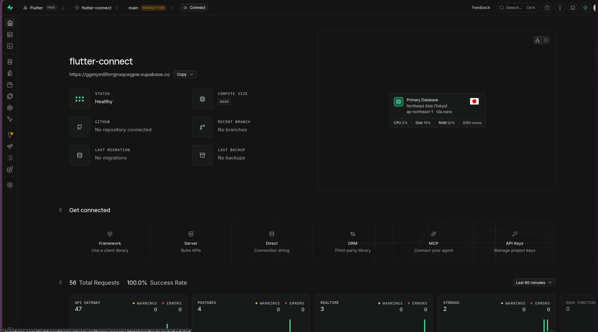

**Gambar 1:** Dashboard project Supabase `flutter-connect` dengan status Healthy.

Dashboard digunakan untuk memantau project, membuka **Table Editor**, dan memeriksa data yang berhasil ditulis oleh aplikasi. URL project dan *publishable key* diambil dari menu **API Keys** untuk dimasukkan ke `lib/config.dart`.

### Skema Tabel dan Nilai Default

Tabel `menu` sudah dibuat pada Latihan 1. Bagian yang paling penting untuk Latihan 2 adalah definisi kolom beserta nilai default-nya.

```sql
create table if not exists public.menu (
  id          bigint primary key generated always as identity,
  nama        text not null,
  kategori    text not null default 'Makanan',
  harga       integer not null default 0,
  deskripsi   text,
  tersedia    boolean not null default true,
  dibuat_pada timestamptz not null default now()
);
```

Policy INSERT dan hak akses Data API yang dipakai pada praktikum ini adalah:

```sql
alter table public.menu enable row level security;

create policy "menu_tambah_publik"
  on public.menu for insert to anon, authenticated
  with check (true);

grant select, insert, update, delete on public.menu to anon;
grant select, insert, update, delete on public.menu to authenticated;
grant usage, select on all sequences in schema public to anon;
grant usage, select on all sequences in schema public to authenticated;
```

Policy `with check (true)` sengaja terbuka untuk praktikum karena aplikasi belum memiliki sistem login. Pola ini tidak boleh dipakai pada aplikasi produksi. Skrip lengkap tetap tersimpan pada `supabase/setup.sql`.

### Dependensi dan Konfigurasi

Package Supabase ditambahkan melalui perintah berikut:

```bash
flutter pub add supabase_flutter
```

`pubspec.yaml` memuat dependensi:

```yaml
dependencies:
  flutter:
    sdk: flutter
  supabase_flutter: ^2.18.3
```

Kredensial dimasukkan ke `lib/config.dart`. File tersebut hanya berisi **publishable key**, bukan *secret key* atau *service_role key*.

```dart
// lib/config.dart
const String supabaseUrl = 'https://xxxxxxxxxxxx.supabase.co';
const String supabaseKey = 'salin-publishable-key-anda-di-sini';
```

File `lib/config.dart` masuk ke `.gitignore`. Sebagai contoh untuk pengumpulan disediakan `lib/config.example.dart`.

### Struktur Project

```text
laprak_10/
├── lib/
│   ├── config.dart
│   ├── config.example.dart
│   ├── main.dart
│   ├── latihan1/
│   │   ├── masalah1.dart ... masalah6.dart
│   ├── latihan2/
│   │   ├── masalah1.dart ... masalah6.dart
│   ├── models/
│   │   └── menu_item.dart
│   ├── services/
│   │   └── menu_service.dart
│   ├── utils/
│   │   └── formatter.dart
│   └── widgets/
│       ├── banner_catatan.dart
│       ├── form_tambah_menu.dart
│       ├── halaman_daftar_menu.dart
│       └── halaman_katalog_menu.dart
├── supabase/
│   └── setup.sql
├── test/
│   └── widget_test.dart
└── pubspec.yaml
```

`main.dart` adalah router yang menampilkan dua section: **Latihan 1** dan **Latihan 2**. Setiap section berisi enam tugas, mengikuti pola kumulatif seperti Laprak 7 dan Laprak 8. Inisialisasi Supabase dilakukan sebelum aplikasi dijalankan.

```dart
Future<void> main() async {
  WidgetsFlutterBinding.ensureInitialized();

  await Supabase.initialize(
    url: supabaseUrl,
    publishableKey: supabaseKey,
  );

  runApp(const PraktikumRouter());
}
```

---

## Latihan 2: Menambah Data dengan INSERT {.page-break}

Latihan 2 melengkapi operasi **Create** pada CRUD. Aplikasi tidak lagi hanya membaca tabel, tetapi dapat menambahkan baris baru melalui formulir. Ada enam tugas yang saling berkaitan:

1. Menambahkan menu baru dari aplikasi.
2. Memeriksa nilai default kolom `id`, `tersedia`, dan `dibuat_pada`.
3. Menguji validasi harga yang bukan angka.
4. Menguji penanganan error saat INSERT gagal.
5. Menambahkan validasi deskripsi maksimal 100 karakter.
6. Menganalisis `Navigator.push<bool>` untuk menerima nilai kembali.

Seluruh tugas memakai komponen yang sama: halaman katalog, formulir tambah menu, dan service `tambahMenu()`. Perbedaan tiap halaman terletak pada catatan pengujian dan perilaku yang ditonjolkan.

### 2.1 Menu Baru dari Aplikasi

#### Masalah

Bagaimana menambahkan data baru ke tabel `menu` langsung dari aplikasi Flutter, lalu membuktikan bahwa data tersebut benar-benar tersimpan di Supabase?

#### Tugas

- Menambahkan satu menu baru melalui formulir di aplikasi.
- Memeriksa hasilnya di **Table Editor** Supabase.
- Memastikan daftar menu dimuat ulang setelah INSERT berhasil.

#### Kode Implementasi

Operasi INSERT dilakukan oleh method `tambahMenu()` pada service. Hanya empat kolom yang dikirim dari aplikasi.

```dart
Future<void> tambahMenu({
  required String nama,
  required String kategori,
  required int harga,
  required String deskripsi,
}) async {
  await Supabase.instance.client.from('menu').insert({
    'nama': nama,
    'kategori': kategori,
    'harga': harga,
    'deskripsi': deskripsi,
  });
}
```

Formulir memvalidasi input terlebih dahulu, kemudian memanggil service dan mengembalikan nilai `true` ke halaman katalog.

```dart
Future<void> _simpan() async {
  if (!_formKey.currentState!.validate()) return;

  setState(() => _sedangMenyimpan = true);

  try {
    await tambahMenu(
      nama: _nama.text.trim(),
      kategori: _kategori,
      harga: int.parse(_harga.text.trim()),
      deskripsi: _deskripsi.text.trim(),
    );

    if (!mounted) return;
    Navigator.pop(context, true);
  } on PostgrestException catch (e) {
    if (!mounted) return;
    setState(() => _sedangMenyimpan = false);
    ScaffoldMessenger.of(context).showSnackBar(
      SnackBar(content: Text('Gagal menyimpan: ${e.message}')),
    );
  } catch (e) {
    if (!mounted) return;
    setState(() => _sedangMenyimpan = false);
    ScaffoldMessenger.of(context).showSnackBar(
      SnackBar(content: Text('Terjadi kesalahan: $e')),
    );
  }
}
```

Halaman katalog membuka formulir dengan `Navigator.push<bool>`. Jika hasilnya `true`, daftar dimuat ulang dan SnackBar ditampilkan.

```dart
Future<void> _bukaFormTambah() async {
  final berhasil = await Navigator.push<bool>(
    context,
    MaterialPageRoute(builder: (_) => const FormTambahMenu()),
  );

  if (berhasil != true) return;

  final berhasilMuat = await _muatUlang(tampilkanPesan: false);
  if (!mounted || !berhasilMuat) return;

  ScaffoldMessenger.of(context).showSnackBar(
    const SnackBar(content: Text('Menu berhasil ditambahkan')),
  );
}
```

Tombol tambah ditempatkan sebagai `FloatingActionButton.extended` pada halaman katalog.

```dart
floatingActionButton: FloatingActionButton.extended(
  onPressed: _bukaFormTambah,
  icon: const Icon(Icons.add),
  label: const Text('Tambah Menu'),
),
```

#### Hasil Eksekusi

Sebelum pengujian, tabel `menu` berisi **enam baris** (id 1 sampai 6). Data baru yang ditambahkan melalui formulir adalah:

| Kolom | Nilai |
|---|---|
| `nama` | Ampela Goreng |
| `kategori` | Camilan |
| `harga` | 15000 |
| `deskripsi` | Hati Ampela ayam yang renyah dan gurih |

Setelah tombol **Simpan** ditekan, aplikasi kembali ke katalog dan baris **Ampela Goreng** muncul di urutan pertama. Tabel bertambah menjadi **tujuh baris** dengan `id = 7`.

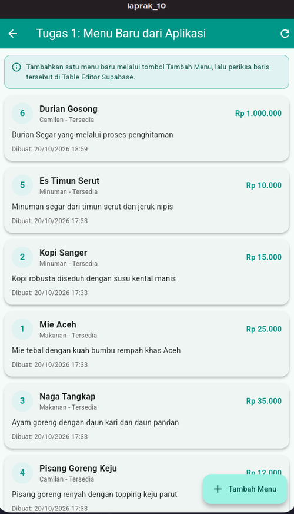

**Gambar 2:** Katalog sebelum data baru ditambahkan, berisi enam baris.

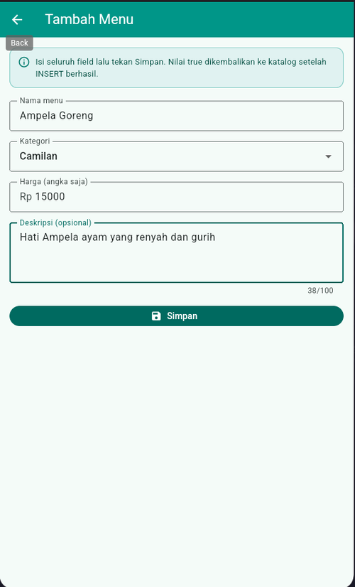

**Gambar 3:** Formulir diisi dengan data Ampela Goreng sebelum disimpan.

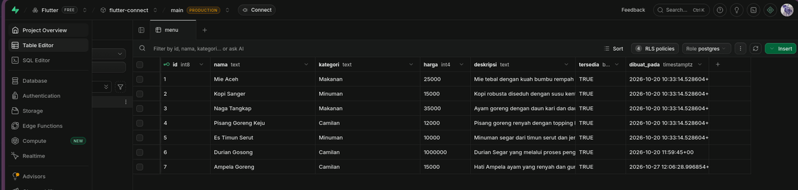

**Gambar 4:** Baris baru dengan id 7 terlihat di Table Editor Supabase.

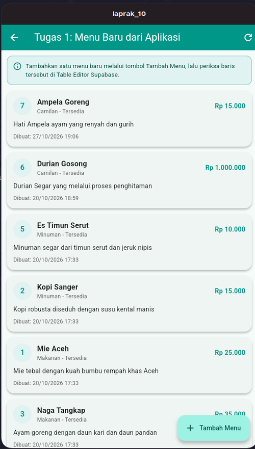

**Gambar 5:** Ampela Goreng muncul di katalog setelah INSERT dan refresh.

#### Pembahasan

Alur INSERT pada Latihan 2 adalah:

```text
FormTambahMenu
      ↓ validasi input
tambahMenu()
      ↓ .insert()
Data API Supabase (PostgREST)
      ↓ INSERT INTO menu ...
PostgreSQL
      ↓
Navigator.pop(context, true)
      ↓
Katalog memuat ulang data
      ↓
SnackBar "Menu berhasil ditambahkan"
```

Aplikasi tidak mengirim kolom `id`, `tersedia`, atau `dibuat_pada`. Ketiga kolom tersebut diisi oleh PostgreSQL. Setelah respons INSERT berhasil, formulir ditutup dengan nilai `true`. Halaman katalog menangkap nilai tersebut, menjalankan query SELECT terbaru, lalu menampilkan data yang sudah diperbarui.

Tombol refresh di AppBar juga diberi umpan balik berupa spinner dan SnackBar. Tujuannya agar pengguna dapat membedakan proses memuat data yang sedang berjalan dari tombol yang tidak merespons.

### 2.2 Nilai Default Kolom Baru

#### Masalah

Berapa nilai kolom `id`, `tersedia`, dan `dibuat_pada` pada baris baru, dan dari mana nilai tersebut berasal jika ketiganya tidak ada di formulir?

#### Tugas

- Memeriksa nilai `id`, `tersedia`, dan `dibuat_pada` pada baris baru.
- Menjelaskan sumber setiap nilai.
- Menjelaskan mengapa kolom `tersedia` tidak perlu dimasukkan pada form INSERT.

#### Kode Implementasi

Definisi tabel menentukan nilai default:

```sql
id          bigint primary key generated always as identity,
tersedia    boolean not null default true,
dibuat_pada timestamptz not null default now()
```

Sementara itu, payload INSERT hanya memuat kolom yang diisi pengguna:

```dart
await Supabase.instance.client.from('menu').insert({
  'nama': nama,
  'kategori': kategori,
  'harga': harga,
  'deskripsi': deskripsi,
});
```

Kolom `id`, `tersedia`, dan `dibuat_pada` sengaja tidak dikirim. Formulir hanya menampilkan nama, kategori, harga, dan deskripsi.

#### Hasil Eksekusi

Baris **Ampela Goreng** yang dibuat pada Tugas 2.1 memiliki nilai berikut:

| Kolom | Nilai pada baris baru | Asal nilai |
|---|---|---|
| `id` | 7 | `generated always as identity` |
| `tersedia` | `TRUE` | default `true` |
| `dibuat_pada` | `2026-10-27 12:06:28.996854+00:00` | default `now()` |
| `nama` | Ampela Goreng | dikirim dari form |
| `kategori` | Camilan | dikirim dari form |
| `harga` | 15000 | dikirim dari form |
| `deskripsi` | Hati Ampela ayam yang renyah dan gurih | dikirim dari form |

Di aplikasi, waktu tersebut tampil sebagai **27/10/2026 19:06** karena `dibuat_pada` dikonversi ke waktu lokal dengan `toLocal()`.

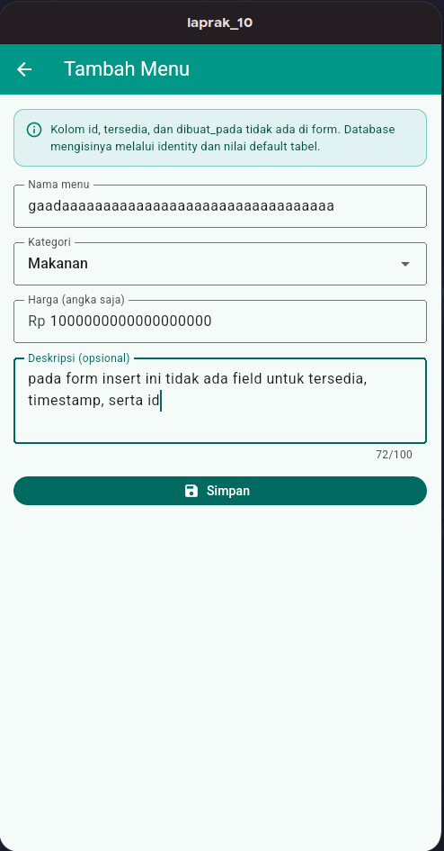

**Gambar 6:** Form INSERT tidak memiliki field untuk `id`, `tersedia`, dan `dibuat_pada`.

#### Pembahasan

Kolom `id` bertipe `bigint` dan memakai `generated always as identity`. PostgreSQL otomatis menghasilkan nilai berikutnya saat baris dimasukkan. Karena itu, aplikasi tidak perlu menghitung ID secara manual.

Kolom `tersedia` bertipe `boolean` dengan default `true`. Menu yang baru ditambahkan dianggap tersedia secara default. Nilai ini tetap penting, tetapi tidak perlu diisi saat INSERT. Perubahan ketersediaan baru relevan pada operasi UPDATE, yaitu saat menu diedit atau ditandai habis. Pada Latihan 3, form edit memiliki `SwitchListTile` untuk mengubah kolom ini.

Kolom `dibuat_pada` bertipe `timestamptz` dengan default `now()`. Waktu dicatat oleh server database, bukan oleh jam perangkat, sehingga konsisten meskipun perangkat pengguna memiliki zona waktu atau jam yang berbeda.

Dengan demikian, form INSERT hanya meminta data yang memang ditentukan pengguna. Kolom teknis dan kolom yang memiliki nilai default diserahkan kepada database. Inilah yang membuat skema database berperan sebagai sumber aturan, bukan hanya tempat menyimpan data.

### 2.3 Validasi Harga Teks

#### Masalah

Apa yang terjadi jika pengguna mengisi harga dengan teks seperti `dua ribu` atau `tidak ada harga`? Apakah request INSERT tetap dikirim ke database?

#### Tugas

- Mengisi kolom harga dengan teks.
- Menekan tombol Simpan.
- Mencatat pesan validasi yang muncul dan menjelaskan apakah request dikirim.

#### Kode Implementasi

Kolom harga divalidasi menggunakan `int.tryParse()`.

```dart
TextFormField(
  controller: _harga,
  keyboardType: TextInputType.number,
  validator: (nilai) {
    if (nilai == null || nilai.trim().isEmpty) {
      return 'Harga wajib diisi';
    }

    final angka = int.tryParse(nilai.trim());
    if (angka == null) {
      return 'Harga harus berupa angka';
    }
    if (angka <= 0) {
      return 'Harga harus lebih dari 0';
    }

    return null;
  },
)
```

Formulir memakai `autovalidateMode: AutovalidateMode.onUserInteraction` agar pesan error langsung muncul setelah pengguna berinteraksi dengan field.

```dart
Form(
  key: _formKey,
  autovalidateMode: AutovalidateMode.onUserInteraction,
  child: ListView(
    // ...
  ),
)
```

#### Hasil Eksekusi

Harga diisi dengan teks **`tidak ada harga yang bisa membayarnya`**. Saat tombol Simpan ditekan, muncul pesan:

> Harga harus berupa angka

Field harga ditandai merah. Formulir tetap terbuka dan data tidak dikirim ke Supabase.

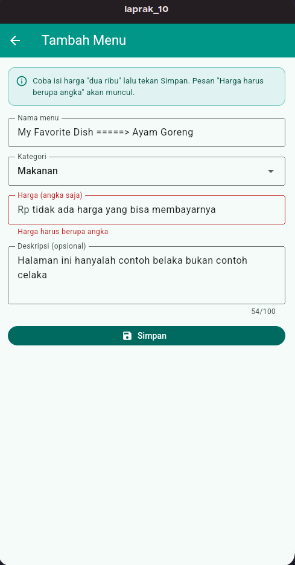

**Gambar 7:** Validasi menolak harga non-angka sebelum request INSERT dikirim.

#### Pembahasan

Method `_simpan()` selalu memanggil `_formKey.currentState!.validate()` terlebih dahulu. Jika ada validator yang mengembalikan pesan error, method langsung berhenti dengan `return`.

```dart
if (!_formKey.currentState!.validate()) return;
```

Akibatnya, baris `tambahMenu()` tidak pernah dieksekusi. Tidak ada request HTTP ke Supabase, tidak ada baris baru, dan tidak ada perubahan pada database. Validasi di sisi client seperti ini mencegah data yang jelas tidak valid dikirim ke server, menghemat waktu, dan memberikan umpan balik yang cepat.

`int.tryParse()` dipilih daripada `int.parse()` karena `tryParse()` mengembalikan `null` saat input bukan angka. Jika memakai `int.parse()`, input `dua ribu` akan melempar `FormatException` sebelum validator sempat menampilkan pesan yang ramah.

### 2.4 Penanganan Error INSERT

#### Masalah

Apa yang terjadi jika operasi INSERT gagal, misalnya karena koneksi terputus? Bagaimana `try/catch` menjaga aplikasi tetap berjalan?

#### Tugas

- Menguji penyimpanan saat koneksi gagal.
- Mengamati pesan error yang muncul.
- Menjelaskan peran `try/catch` dan apa yang terjadi bila blok tersebut dihapus.

#### Kode Implementasi

Operasi INSERT dibungkus dalam `try/catch`. `PostgrestException` menangani error yang dikembalikan Supabase, sedangkan `catch` terakhir menangani error umum seperti koneksi terputus.

```dart
try {
  await tambahMenu(
    nama: _nama.text.trim(),
    kategori: _kategori,
    harga: int.parse(_harga.text.trim()),
    deskripsi: _deskripsi.text.trim(),
  );

  if (!mounted) return;
  Navigator.pop(context, true);
} on PostgrestException catch (e) {
  if (!mounted) return;
  setState(() => _sedangMenyimpan = false);
  ScaffoldMessenger.of(context).showSnackBar(
    SnackBar(content: Text('Gagal menyimpan: ${e.message}')),
  );
} catch (e) {
  if (!mounted) return;
  setState(() => _sedangMenyimpan = false);
  ScaffoldMessenger.of(context).showSnackBar(
    SnackBar(content: Text('Terjadi kesalahan: $e')),
  );
}
```

Untuk memperoleh error secara konsisten tanpa mematikan jaringan, form Tugas 4 menyediakan switch simulasi:

```dart
if (_simulasiError) {
  throw Exception('Koneksi internet terputus (simulasi)');
}
```

Switch tersebut hanya dipakai untuk pengujian di Latihan 2. Pada penggunaan normal, switch dimatikan dan alur INSERT berjalan seperti biasa.

#### Hasil Eksekusi

Switch **Simulasikan koneksi gagal** diaktifkan, lalu tombol Simpan ditekan. Aplikasi tidak crash dan tetap berada di halaman formulir. SnackBar menampilkan pesan:

> Terjadi kesalahan: Exception: Koneksi internet terputus (simulasi)

Tombol Simpan kembali aktif setelah error ditangani, sehingga pengguna dapat mencoba lagi.

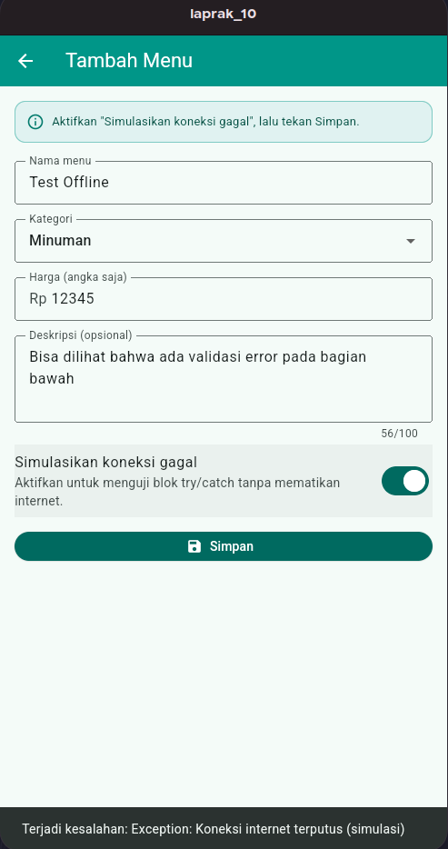

**Gambar 8:** Blok `try/catch` menangkap error dan menampilkan SnackBar tanpa menutup aplikasi.

#### Pembahasan

Operasi tulis berbeda dari operasi baca. Jika INSERT gagal dan error tidak ditangani, exception akan menjadi *unhandled exception*. Pada kondisi tertentu aplikasi dapat berhenti, atau setidaknya state `_sedangMenyimpan` tetap `true` sehingga tombol Simpan terus menampilkan status “Menyimpan...” dan tidak bisa dipakai lagi.

Dengan `try/catch`, aplikasi dapat:

1. Menghentikan proses penyimpanan secara terkendali.
2. Mengembalikan state `_sedangMenyimpan` menjadi `false`.
3. Menampilkan pesan error yang dapat dibaca pengguna.
4. Tetap berada di halaman formulir agar data yang sudah diisi tidak hilang.

Untuk pengujian sebenarnya, koneksi internet dapat dimatikan lalu tombol Simpan ditekan. Error yang muncul akan ditangani oleh blok `catch` yang sama. Switch simulasi hanya membuat pengujian lebih cepat dan dapat diulang tanpa mengubah jaringan perangkat.

### 2.5 Validasi Deskripsi 100 Karakter

#### Masalah

Bagaimana membatasi deskripsi agar tidak melebihi 100 karakter, dan mengapa input yang terlalu panjang harus ditolak sebelum dikirim ke database?

#### Tugas

- Menambahkan validasi maksimal 100 karakter pada kolom deskripsi.
- Menguji dengan teks lebih dari 100 karakter.
- Memastikan data tidak tersimpan saat validasi gagal.

#### Kode Implementasi

Kolom deskripsi memakai `maxLength: 100` dan validator manual. `MaxLengthEnforcement.none` dipakai agar pengguna tetap dapat mengetik lebih dari 100 karakter, sehingga pesan validasi dapat ditampilkan.

```dart
TextFormField(
  controller: _deskripsi,
  maxLines: 3,
  maxLength: 100,
  maxLengthEnforcement: MaxLengthEnforcement.none,
  decoration: const InputDecoration(
    labelText: 'Deskripsi (opsional)',
    hintText: 'Deskripsi singkat, maksimal 100 karakter',
    border: OutlineInputBorder(),
  ),
  validator: (nilai) {
    if (nilai != null && nilai.length > 100) {
      return 'Deskripsi maksimal 100 karakter';
    }
    return null;
  },
)
```

#### Hasil Eksekusi

Deskripsi diisi dengan teks sepanjang **129 karakter**. Penghitung di bawah field menunjukkan **129/100**, field berubah merah, dan muncul pesan:

> Deskripsi maksimal 100 karakter

Formulir tidak ditutup dan tidak ada request INSERT yang dikirim.

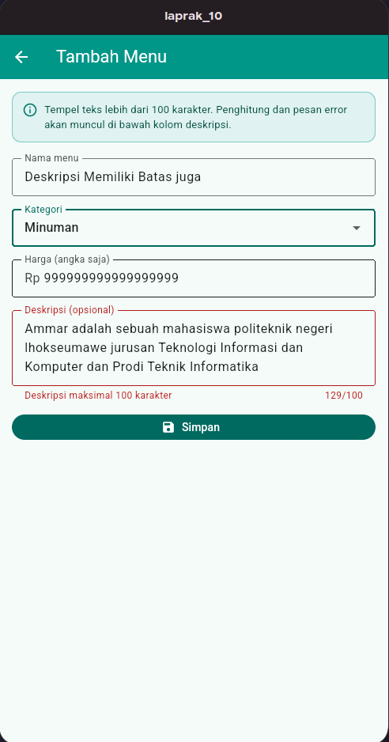

**Gambar 9:** Validasi deskripsi menolak input 129 karakter.

#### Pembahasan

Atribut `maxLength: 100` menampilkan penghitung karakter, sedangkan validator memeriksa panjang teks secara eksplisit. Jika `MaxLengthEnforcement.enforced` dipakai, Flutter akan memotong input setelah 100 karakter sehingga pengguna tidak melihat pesan error. Dengan `MaxLengthEnforcement.none`, input tetap diterima sementara validasi menolak penyimpanan.

Pemeriksaan dilakukan sebelum `tambahMenu()` dipanggil. Karena itu, data yang melebihi batas tidak pernah mencapai database. Jika batas ini juga ingin dijaga di sisi server, kolom PostgreSQL dapat memakai tipe `varchar(100)` atau menambahkan `check (char_length(deskripsi) <= 100)`. Validasi client tetap diperlukan untuk pengalaman pengguna, tetapi validasi server tetap menjadi pengaman terakhir.

### 2.6 Navigator.push<bool>

#### Masalah

Apa perbedaan `Navigator.push` pada Pertemuan 3 yang mengirim data ke halaman berikutnya dengan `Navigator.push<bool>` pada Latihan 2 yang menerima data kembali?

#### Tugas

- Menjelaskan arah perpindahan data pada kedua pola.
- Menunjukkan bagaimana nilai `true` dan `false` dari halaman formulir diterima halaman katalog.
- Menjelaskan kapan masing-masing pola digunakan.

#### Kode Implementasi

Formulir mengembalikan nilai `true` setelah INSERT berhasil.

```dart
await tambahMenu(
  nama: _nama.text.trim(),
  kategori: _kategori,
  harga: int.parse(_harga.text.trim()),
  deskripsi: _deskripsi.text.trim(),
);

if (!mounted) return;
Navigator.pop(context, true);
```

Halaman katalog menunggu nilai tersebut dan hanya memuat ulang data jika hasilnya `true`.

```dart
final berhasil = await Navigator.push<bool>(
  context,
  MaterialPageRoute(builder: (_) => const FormTambahMenu()),
);

if (berhasil != true) return;

final berhasilMuat = await _muatUlang(tampilkanPesan: false);
if (!mounted || !berhasilMuat) return;

ScaffoldMessenger.of(context).showSnackBar(
  const SnackBar(content: Text('Menu berhasil ditambahkan')),
);
```

Halaman demo juga menyediakan dua tombol untuk mengembalikan nilai boolean:

```dart
FilledButton.icon(
  onPressed: () => Navigator.pop(context, true),
  icon: const Icon(Icons.check),
  label: const Text('Simpan (return true)'),
),

OutlinedButton.icon(
  onPressed: () => Navigator.pop(context, false),
  icon: const Icon(Icons.close),
  label: const Text('Batal (return false)'),
),
```

#### Hasil Eksekusi

Ketika tombol **Simpan (return true)** dipilih, halaman sebelumnya menerima nilai `true` bertipe `bool`.

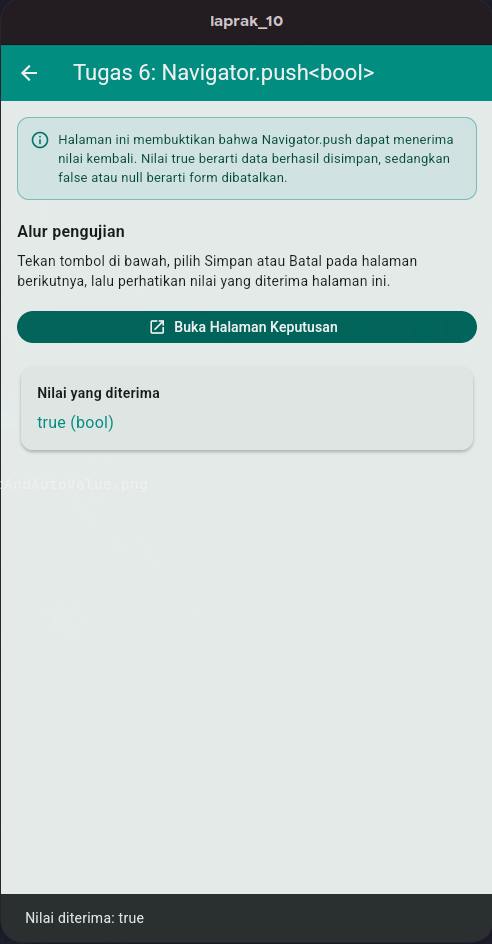

**Gambar 10:** Halaman menerima nilai kembali `true`.

Ketika tombol **Batal (return false)** dipilih, halaman sebelumnya menerima nilai `false`.

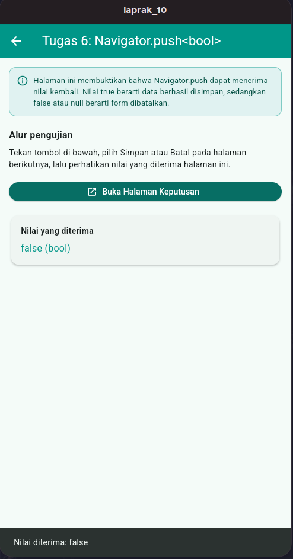

**Gambar 11:** Halaman menerima nilai kembali `false`.

#### Pembahasan

`Navigator.push<T>()` mengembalikan `Future<T?>`. Nilai `T` diisi melalui `Navigator.pop(context, nilai)`. Jika pengguna menutup halaman dengan tombol back tanpa memilih tombol apa pun, hasilnya adalah `null`.

Perbedaan kedua pola dapat diringkas sebagai berikut.

| Aspek | Pertemuan 3 | Latihan 2 |
|---|---|---|
| Arah data | Halaman asal mengirim objek ke halaman detail | Halaman form mengirim hasil ke halaman asal |
| Nilai kembali | Umumnya tidak dipakai | `bool?` untuk menandai berhasil/batal |
| Contoh penggunaan | Navigasi ke detail resep | Form tambah/edit, konfirmasi, pemilihan opsi |
| Pemeriksaan hasil | Tidak perlu | `if (berhasil != true) return;` |

Pola `Navigator.push<bool>` cocok dipakai ketika halaman tujuan menghasilkan keputusan atau status yang memengaruhi halaman sebelumnya. Pada Latihan 2, status tersebut menentukan apakah katalog perlu dimuat ulang dan apakah SnackBar keberhasilan ditampilkan. Pemeriksaan `!= true` penting karena nilai `null` juga mungkin terjadi saat pengguna menekan tombol back.

### 2.7 Catatan Keamanan INSERT

Aplikasi memakai **publishable key** yang aman disertakan di client selama RLS dan policy dikonfigurasi dengan benar. Kunci ini bukan pengganti autentikasi; ia hanya mengidentifikasi project Supabase.

Policy INSERT pada praktikum ini memakai `with check (true)`, sehingga siapa pun yang memiliki publishable key dapat menambahkan baris ke tabel `menu`. Policy tersebut hanya sesuai untuk latihan. Pada aplikasi nyata, INSERT harus dibatasi berdasarkan pengguna yang terautentikasi, misalnya:

```sql
create policy "menu_tambah_pemilik"
  on public.menu for insert to authenticated
  with check ((select auth.uid()) = user_id);
```

**Secret key** atau **service_role key** tidak boleh dimasukkan ke aplikasi Flutter, laporan, maupun repositori karena kunci tersebut dapat menembus RLS.

---

## Kesimpulan

### Ringkasan Temuan

1. **INSERT dari aplikasi berhasil.** Data Ampela Goreng yang dikirim melalui formulir tersimpan sebagai baris baru dengan `id = 7` dan langsung tampil setelah katalog dimuat ulang.
2. **Database mengisi nilai default.** `id` berasal dari identity, `tersedia` memakai default `true`, dan `dibuat_pada` memakai default `now()`. Ketiganya tidak perlu dikirim dari form.
3. **Validasi client mencegah request yang tidak valid.** Harga non-angka dan deskripsi lebih dari 100 karakter ditolak sebelum `tambahMenu()` dipanggil.
4. **`try/catch` menjaga aplikasi tetap terkendali.** Saat INSERT gagal, state penyimpanan dikembalikan, pesan error ditampilkan, dan pengguna tetap berada di form.
5. **`Navigator.push<bool>` menerima status dari form.** Nilai `true` memicu refresh dan SnackBar, sedangkan `false` atau `null` dianggap batal.
6. **Publishable key aman hanya jika RLS benar.** Policy `with check (true)` memadai untuk praktikum, tetapi harus dipersempit sebelum aplikasi dipakai secara luas.

### Kendala dan Solusi

| Kendala | Penyebab | Solusi |
|---|---|---|
| `new row violates row-level security policy` | Policy INSERT belum dibuat | Jalankan policy `menu_tambah_publik` dan `grant insert` |
| `Invalid API key` | URL atau key di `lib/config.dart` salah | Periksa kembali URL dan publishable key |
| Baris baru tidak muncul setelah Simpan | Katalog belum dimuat ulang | Pastikan `Navigator.pop(context, true)` dan `_muatUlang()` dijalankan |
| Pesan `Harga harus berupa angka` muncul | Input harga bukan angka | Isi harga dengan angka positif; ini perilaku validasi yang benar |
| Pesan `Deskripsi maksimal 100 karakter` muncul | Deskripsi lebih dari 100 karakter | Persingkat deskripsi; validasi sengaja menolak data |
| Tombol refresh terlihat tidak merespons | Tidak ada umpan balik visual saat query berjalan | Spinner dan SnackBar ditambahkan pada AppBar |
| Error simulasi muncul terus | Switch simulasi masih aktif | Matikan switch sebelum menyimpan data sungguhan |

### Saran untuk Praktikum Selanjutnya

1. Lanjutkan ke Latihan 3 untuk melengkapi `UPDATE`, `DELETE`, dan perubahan status ketersediaan menu.
2. Pertahankan pemisahan `models/`, `services/`, dan `widgets/` agar halaman tugas berikutnya tidak menduplikasi kode.
3. Tambahkan validasi sisi server, misalnya `check` untuk harga dan panjang deskripsi, sebagai pengaman terakhir.
4. Persempit policy RLS setelah fitur autentikasi tersedia agar setiap pengguna hanya dapat menulis datanya sendiri.
5. Simpan `lib/config.dart` di luar repositori dan gunakan `config.example.dart` saat pengumpulan.

---

*Laporan ini disusun sebagai bagian dari tugas Praktikum Pemrograman Mobile, Pertemuan 5 — Latihan 2.*
