# Laporan Praktikum Pemrograman Mobile
## Pertemuan 4: HTTP, JSON, dan FutureBuilder

**Nama:** Ammar  
**NIM:** 2024573010129  
**Kelas:** TI3B  
**Mata Kuliah:** Praktikum Pemrograman Mobile (With Flutter)  
**Dosen:** Muhammad Rizka  
**Tanggal Praktikum:** 6 - 10 - 2026  

---

<!-- ## Daftar Isi

1. [Pendahuluan](#pendahuluan)
2. [Latihan 1: Permintaan HTTP Pertama & JSON Mentah](#latihan-1-permintaan-http-pertama--json-mentah)
3. [Latihan 2: Model Class + ListView.builder](#latihan-2-model-class--listviewbuilder)
4. [Kesimpulan](#kesimpulan)

--- -->

## Pendahuluan

Praktikum ini bertujuan untuk mempelajari cara mengambil data dari internet menggunakan Flutter. Fokus utama meliputi penggunaan package `http`, parsing JSON, pengelolaan state dengan `Future` dan `async/await`, serta penampilan data menggunakan `FutureBuilder`. API yang digunakan adalah TheMealDB, sebuah API gratis untuk data resep makanan.

### Alat dan Bahan

- Flutter SDK
- Android Studio / VS Code
- Chrome (Dengan Ekstensi Android Simulator)
- Koneksi Internet
- API: TheMealDB (`https://www.themealdb.com/api/json/v1/1/`)

### Konfigurasi Default

1. Menambahkan Http kedalam package flutter  
   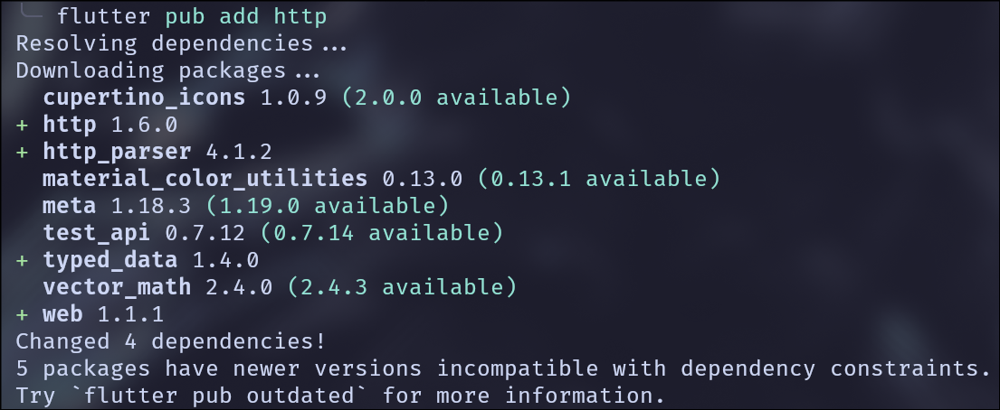

2. Konfirmasi pada pubspec.yaml  
   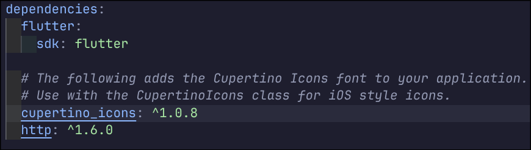


## Latihan 1: Permintaan HTTP Pertama & JSON Mentah

### 1.1 Verifikasi Koneksi API dan Respons JSON

#### Masalah

Bagaimana membuktikan data benar-benar datang dari server (bukan hardcoded)?

#### Tugas

- Catat status code (harus 200), jumlah item dalam respons, dan struktur JSON item pertama
- Verifikasi endpoint dengan browser terlebih dahulu

#### Kode Implementasi

```dart
import 'dart:convert';
import 'package:flutter/material.dart';
import 'package:http/http.dart' as http;

const String urlDaftar = 'https://www.themealdb.com/api/json/v1/1/filter.php?c=Seafood';

Future<void> ambilData() async {
  try {
    final response = await http.get(Uri.parse(urlDaftar));
    
    if (response.statusCode == 200) {
      final data = jsonDecode(response.body) as Map<String, dynamic>;
      final daftar = (data['meals'] as List<dynamic>?) ?? const [];
      
      print('Status code: ${response.statusCode}');
      print('Jumlah item: ${daftar.length}');
      print('Item pertama: ${daftar.first}');
    } else {
      print('Server membalas dengan status ${response.statusCode}');
    }
  } catch (e) {
    print('Gagal terhubung: $e');
  }
}
```

#### Hasil Eksekusi

- **Status Code:** 200
- **Jumlah Item:** [Isi dengan jumlah yang didapat]
- **Struktur JSON:** Object dengan key `meals` yang berisi array

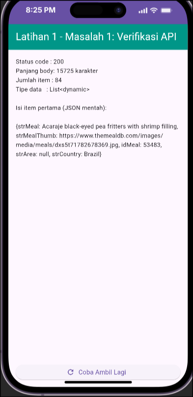

**Gambar 1.1:** Tampilan aplikasi menampilkan status code 200 dan JSON mentah

#### Pembahasan

Endpoint `filter.php?c=Seafood` mengembalikan respons berupa JSON dengan struktur `{"meals": [...]}` di mana `meals` adalah array yang berisi objek-objek resep. Status code 200 menandakan request berhasil diproses oleh server.


### 1.2 Eksperimen Kategori API

#### Masalah

Bagaimana perilaku API saat parameter kategori diganti?

#### Tugas

- Ganti `c=Seafood` → `c=Dessert` dan amati perubahan jumlah item
- Analisis: Mengapa jumlah item berubah?

#### Kode Implementasi (Perubahan)

```dart
// Sebelum:
const String urlDaftar = 'https://www.themealdb.com/api/json/v1/1/filter.php?c=Seafood';

// Sesudah:
const String urlDaftar = 'https://www.themealdb.com/api/json/v1/1/filter.php?c=Dessert';
```

#### Hasil Eksekusi

- **Jumlah Item Seafood:** 84
- **Jumlah Item Dessert:** 168

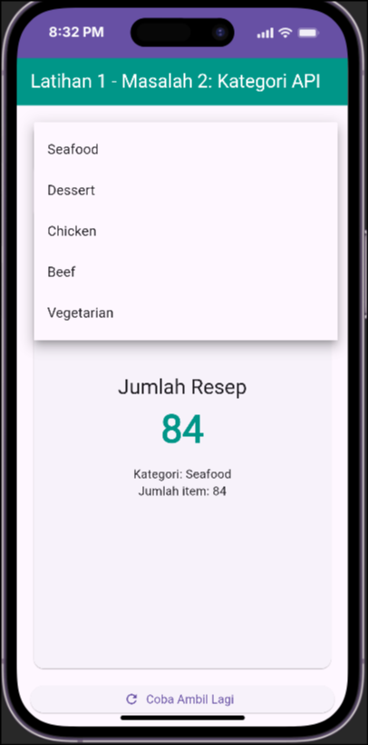

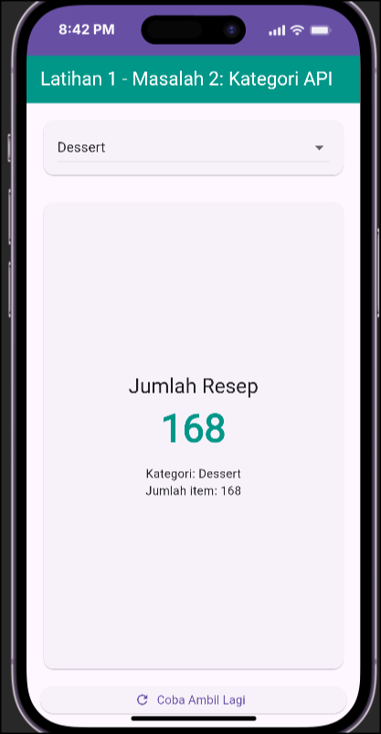

**Gambar 1.2:** Perbandingan jumlah item antar kategori (Seafood vs Dessert)

#### Pembahasan

API bersifat dinamis. Parameter `c=` (category) menentukan filter data yang dikembalikan. Setiap kategori memiliki jumlah resep yang berbeda-beda. Hal ini membuktikan bahwa data benar-benar berasal dari server, bukan hardcoded.


### 1.3 Penanganan Error: URL Rusak vs. Status Code

#### Masalah

Perbedaan error jaringan vs. error server

#### Tugas

- Ubah `filter.php` → `filterr.php` (URL salah)
- Pertanyaan kritis: Masuk ke blok `catch` atau cabang `statusCode != 200`?

#### Kode Implementasi (URL Rusak)

```dart
// URL yang sengaja rusak
const String urlSalah = 'https://www.themealdb.com/api/json/v1/1/filterr.php?c=Seafood';

Future<void> ambilDataSalah() async {
  try {
    final response = await http.get(Uri.parse(urlSalah));
    
    if (response.statusCode == 200) {
      // Tidak akan sampai sini
    } else {
      print('Server membalas dengan status ${response.statusCode}');
    }
  } catch (e) {
    print('Error: $e');
  }
}
```

#### Hasil Eksekusi

- **Hasil:** Masuk ke blok `statusCode != 200` (status 404)

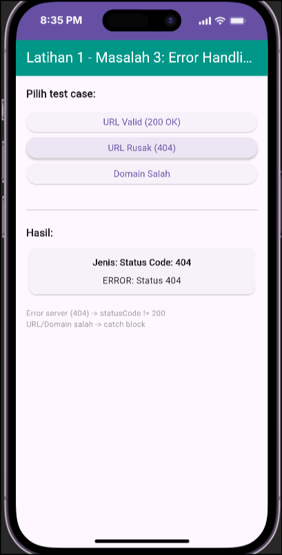

**Gambar 1.3:** Error 404 Not Found saat URL rusak

#### Pembahasan

- **Error jaringan** (DNS failure, timeout, no connection) → Masuk ke blok `catch`
- **Error server** (404, 500, dll.) → Masuk ke cabang `statusCode != 200`

Perbedaan ini penting untuk implementasi error handling yang tepat. Error 404 berarti server ditemukan tetapi endpoint tidak valid, sehingga tidak masuk ke `catch`.


### 1.4 Kegunaan `await` dalam Async Programming

#### Masalah

Mengapa `await` diperlukan?

#### Tugas

- Hapus `await` di `http.get(...)`
- Amati error yang muncul

#### Kode Implementasi (Tanpa `await`)

```dart
// Tanpa await (SALAH)
Future<void> ambilDataSalah() async {
  final response = http.get(Uri.parse(urlDaftar));  // Tanpa await
  print(response.statusCode);  // ERROR: statusCode tidak dikenali
}
```

#### Hasil Eksekusi

- **Error:** `The getter 'statusCode' isn't defined for the type 'Future<Response>'`

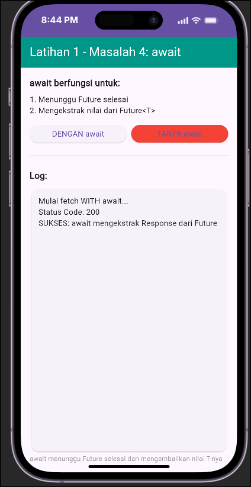

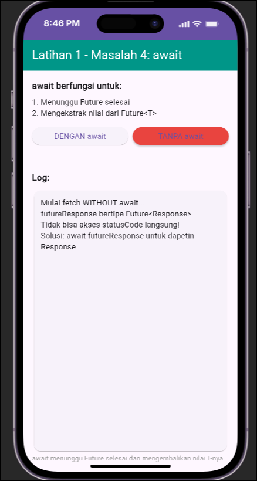

**Gambar 1.4:** Perbandingan Penggunaan Await dan tidak

#### Pembahasan

`await` berfungsi untuk:

1. Menunggu `Future` selesai eksekusi
2. Mengekstrak nilai hasil (`Response`) dari `Future<Response>`

Tanpa `await`, variabel `response` bertipe `Future<Response>`, bukan `Response`. Oleh karena itu, properti `statusCode` yang dimiliki oleh `Response` tidak dapat diakses.


### 1.5 Penanganan Koneksi Jaringan Terputus

#### Masalah

Bagaimana aplikasi merespons saat offline?

#### Tugas

- Matikan internet (mode pesawat)
- Tekan tombol "Coba Ambil Lagi"

#### Kode Implementasi

```dart
ElevatedButton.icon(
  onPressed: ambilData,
  icon: const Icon(Icons.refresh),
  label: const Text('Coba Ambil Lagi'),
)

// Di dalam ambilData():
try {
  final response = await http.get(Uri.parse(urlDaftar));
  // ...
} catch (e) {
  // Akan masuk ke sini saat offline
  print('Gagal terhubung: $e');
  // Contoh: SocketException: Connection failed
}
```

#### Hasil Eksekusi

- **Error:** `SocketException: Connection failed`
- Masuk ke blok `catch`

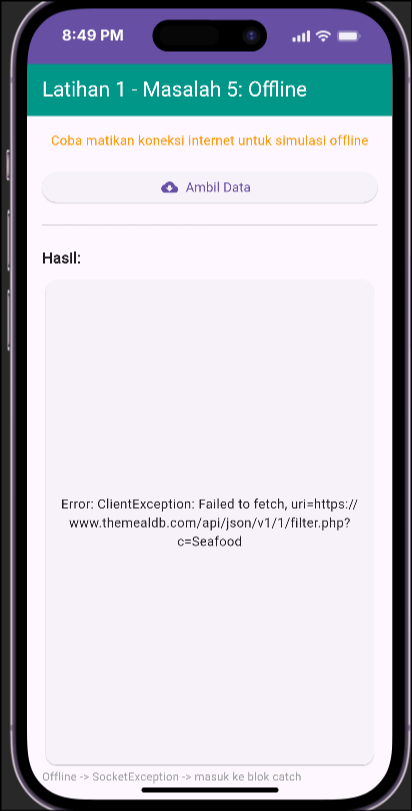

**Gambar 1.5:** Error SocketException saat koneksi terputus (mode pesawat)

#### Pembahasan

Saat perangkat offline, `http.get()` akan melempar `SocketException` yang ditangkap oleh blok `catch`. Hal ini berbeda dengan error server (seperti 404) yang ditangani di blok `if (response.statusCode != 200)`.


### 1.6 State Management: Penundaan `setState`

#### Masalah

Mengapa `await` tidak langsung dimasukkan ke `setState`?

#### Tugas

- Jelaskan konsep penundaan `setState`

#### Kode Implementasi

```dart
// SALAH: setState langsung dengan await
void initState() {
  super.initState();
  setState(() {
    pesan = ambilData();  // SALAH: ambilData() adalah Future, bukan String
  });
}

// BENAR: Tunggu data selesai, baru setState
Future<void> muatData() async {
  setState(() {
    sedangMemuat = true;
    pesanError = '';
  });

  try {
    final hasil = await ambilData();  // Tunggu sampai selesai
    setState(() {
      pesan = hasil;
      sedangMemuat = false;
    });
  } catch (e) {
    setState(() {
      pesanError = e.toString();
      sedangMemuat = false;
    });
  }
}
```

#### Pembahasan

`setState` berfungsi untuk **membangun ulang widget** dengan state terbaru. Sementara `await` **menunggu data** dari operasi async. 

Jika `setState` dipanggil langsung dengan `await`, widget akan direbuild **sebelum data siap**, sehingga:

1. Widget menampilkan state kosong
2. Data yang benar belum tersedia
3. UI tidak update dengan benar

Solusinya: Tunggu data selesai (`await`), baru panggil `setState` untuk update UI.


## Latihan 2: Model Class + ListView.builder

### 2.1 Dinamika Data Berdasarkan Kategori

#### Masalah

Bagaimana perubahan kategori mempengaruhi data?

#### Tugas

- Ganti `c=Seafood` → `c=Chicken`
- Catat jumlah item yang tampil

#### Kode Implementasi

```dart
// Di file service/api.dart
const String urlDaftar = 'https://www.themealdb.com/api/json/v1/1/filter.php?c=Chicken';

// Di widget:
Future<List<Meal>> ambilDaftarMeal() async {
  final response = await http.get(Uri.parse(urlDaftar));
  
  if (response.statusCode != 200) {
    throw Exception('Server membalas status ${response.statusCode}');
  }

  final data = jsonDecode(response.body) as Map<String, dynamic>;
  final daftar = (data['meals'] as List<dynamic>?) ?? const [];
  
  return daftar
      .map((item) => Meal.fromJson(item as Map<String, dynamic>))
      .toList();
}
```

#### Hasil Eksekusi

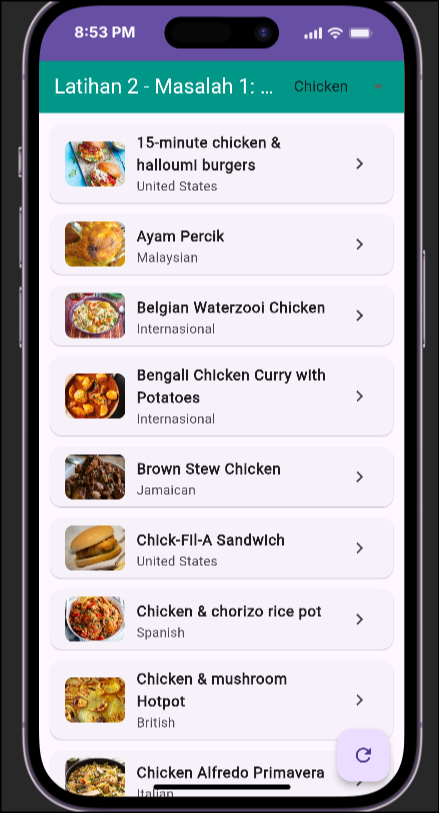

**Gambar 2.1:** Daftar resep kategori Chicken

#### Pembahasan

Endpoint `filter.php` menerapkan filtering berdasarkan kategori. Setiap kategori memiliki jumlah data yang berbeda. Kategori Chicken memiliki jumlah resep yang lebih banyak dibandingkan Seafood.


### 2.2 Kekurangan Data di Endpoint `filter.php`

#### Masalah

Tidak semua field tersedia di semua endpoint

#### Tugas

- Tambahkan field `kategori` (key: `strCategory`) di class `Meal`
- Pertanyaan: Apakah isinya terisi?

#### Kode Implementasi

```dart
class Meal {
  final String id;
  final String nama;
  final String gambar;
  final String area;
  final String? kategori;  // Nullable karena filter.php tidak menyediakannya

  const Meal({
    required this.id,
    required this.nama,
    required this.gambar,
    required this.area,
    this.kategori,  // Default null
  });

  factory Meal.fromJson(Map<String, dynamic> json) {
    return Meal(
      id: json['idMeal'] as String? ?? '',
      nama: json['strMeal'] as String? ?? 'Tanpa Nama',
      gambar: json['strMealThumb'] as String? ?? '',
      area: json['strArea'] as String? ?? 'Internasional',
      kategori: json['strCategory'] as String?,  // Nullable
    );
  }
}
```

#### Hasil Eksekusi

- **Field `kategori`:** `null` (kosong)

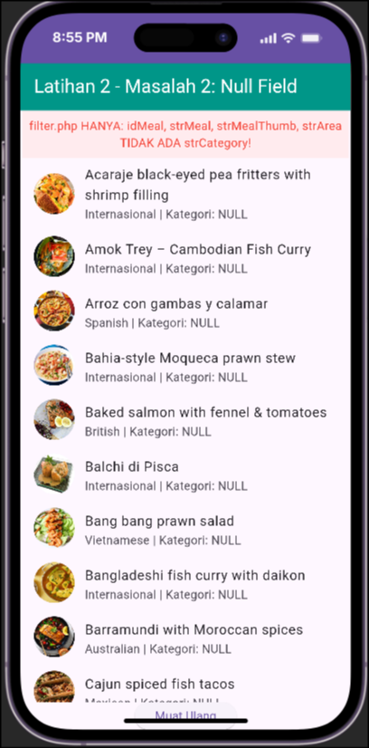

**Gambar 2.2:** Field kategori menampilkan null karena endpoint filter.php tidak menyediakan strCategory

#### Pembahasan

**Alasan:** Endpoint `filter.php` **hanya menyediakan** field: `idMeal`, `strMeal`, `strMealThumb`, `strArea`. Field `strCategory` **tidak ada** di respons ini.

**Kesimpulan:** Halaman detail **harus meminta data sendiri** ke server menggunakan endpoint `lookup.php?i={idMeal}` yang menyediakan semua field termasuk `strCategory` dan `strInstructions`.


### 2.3 Dynamic UI: Menampilkan Jumlah Item

#### Masalah

Bagaimana menampilkan informasi jumlah data secara real-time?

#### Tugas

- Tampilkan jumlah item di AppBar (contoh: `Katalog Resep (85)`)

#### Kode Implementasi

```dart
// Di dalam widget build:
appBar: AppBar(
  title: Text('Katalog Resep (${daftarMeal.length})'),
  backgroundColor: Colors.teal,
  foregroundColor: Colors.white,
),
```

#### Hasil Eksekusi

- AppBar menampilkan: `Katalog Resep (XX)` di mana XX adalah jumlah item saat ini

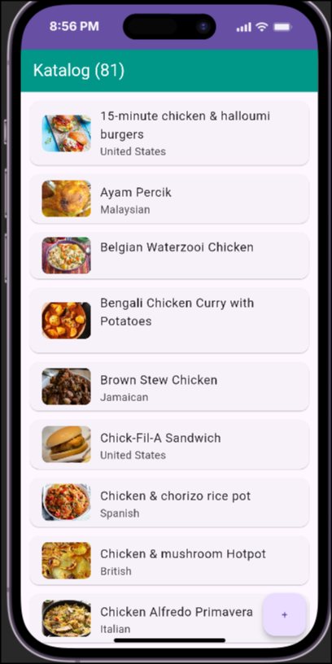

**Gambar 2.3:** AppBar menampilkan jumlah item secara dinamis

#### Pembahasan

Dengan menambahkan `${daftarMeal.length}` di AppBar, UI akan otomatis update saat `daftarMeal` berubah (saat data dimuat ulang). Ini merupakan implementasi sederhana dari **reactive UI** di Flutter.


### 2.4 Penanganan Error Gambar

#### Masalah

Bagaimana merespons kegagalan pemuatan gambar?

#### Tugas

- Hapus `errorBuilder` dari `Image.network`
- Ubah URL gambar menjadi invalid
- Amati perbedaan dengan/tanpa `errorBuilder`

#### Kode Implementasi

```dart
// Tanpa errorBuilder (SALAH)
Image.network(
  'https://contoh-salah.com/x.jpg',
  width: 64,
  height: 64,
  fit: BoxFit.cover,
),

// Dengan errorBuilder (BENAR)
Image.network(
  meal.gambar,
  width: 64,
  height: 64,
  fit: BoxFit.cover,
  errorBuilder: (context, error, stackTrace) {
    return Container(
      width: 64,
      height: 64,
      color: Colors.grey.shade200,
      child: const Icon(Icons.broken_image, color: Colors.grey),
    );
  },
),
```

#### Hasil Eksekusi

- **Tanpa errorBuilder:** Kotak merah dengan error "Exception caught by image resource service"
- **Dengan errorBuilder:** Icon placeholder yang rapi

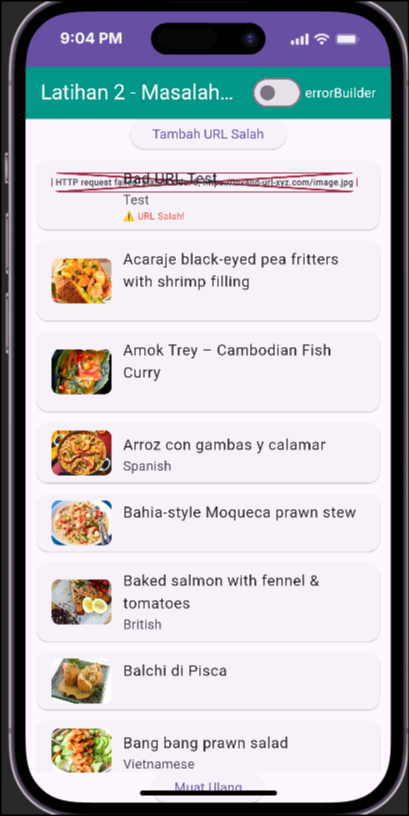

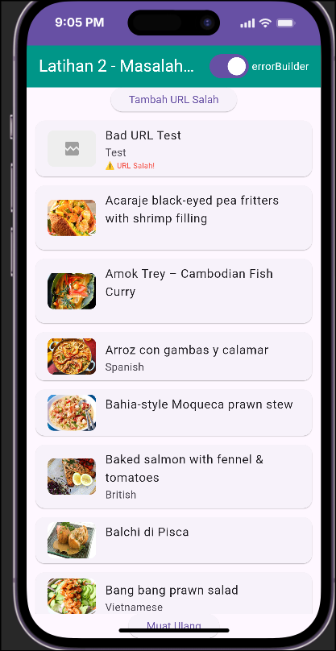

**Gambar 2.4:** Perbandingan penggunaan errorBuilder dan tidak

#### Pembahasan

`errorBuilder` adalah **keharusan** saat menggunakan `Image.network` karena:

1. URL gambar bisa rusak/berubah
2. Perangkat bisa offline
3. Server gambar bisa down

Tanpa `errorBuilder`, aplikasi menampilkan error yang buruk dari sisi UX. Dengan `errorBuilder`, aplikasi menampilkan fallback yang user-friendly.


### 2.5 Fungsi `factory fromJson` dan Null Safety

#### Masalah

Bagaimana `factory` mengonversi JSON ke objek Dart?

#### Tugas

- Jelaskan `factory Meal.fromJson`
- Apa jadinya jika `?? 'Tanpa Nama'` dihapus?

#### Kode Implementasi

```dart
// BENAR: Dengan null safety
factory Meal.fromJson(Map<String, dynamic> json) {
  return Meal(
    id: json['idMeal'] as String? ?? '',
    nama: json['strMeal'] as String? ?? 'Tanpa Nama',
    gambar: json['strMealThumb'] as String? ?? '',
    area: json['strArea'] as String? ?? 'Internasional',
  );
}

// SALAH: Tanpa null safety
factory Meal.fromJson(Map<String, dynamic> json) {
  return Meal(
    id: json['idMeal'] as String,  // Akan crash jika null
    nama: json['strMeal'] as String,  // Akan crash jika null
  );
}
```

#### Hasil Eksekusi

- **Dengan `??`:** Aplikasi aman, field terisi default value
- **Tanpa `??`:** `type 'Null' is not a subtype of type 'String'` (crash)

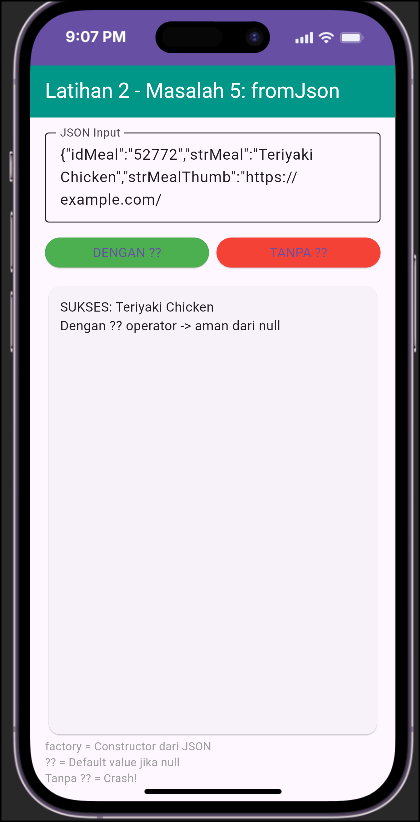

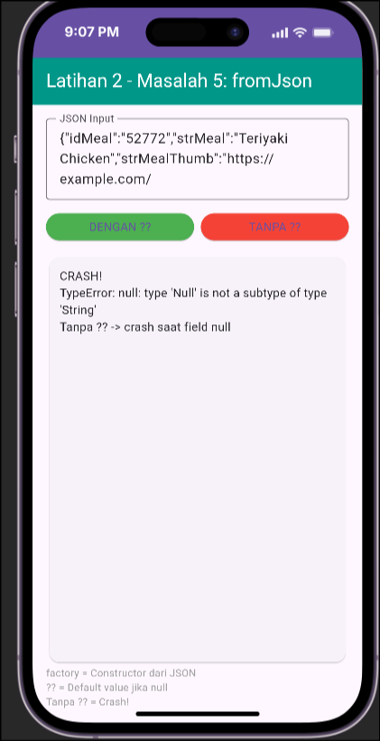

**Gambar 2.5:** Perbandingan penggunaan ?? dan tanpanya

#### Pembahasan

**`factory`** adalah constructor khusus yang:

1. Bukan instance method, melainkan class-level method
2. Dapat mengembalikan instance yang sudah ada (tidak selalu baru)
3. Di sini berfungsi untuk **mengonversi JSON (Map) → Objek Meal**

**`??` (null-coalescing operator):**

- Jika value sebelah kiri `null`, gunakan value sebelah kanan
- **Penting:** JSON dari API bisa berisi `null` untuk field tertentu
- Tanpa `??`, aplikasi crash saat field JSON adalah `null`


### 2.6 Pull-to-Refresh dengan `RefreshIndicator`

#### Masalah

Bagaimana implementasi refresh manual?

#### Tugas

- Bungkus `ListView` dengan `RefreshIndicator`
- Implementasi: `onRefresh: muatData`

#### Kode Implementasi

```dart
// BENAR: RefreshIndicator membungkus ListView
Scaffold(
  appBar: AppBar(title: Text('Katalog Resep')),
  body: RefreshIndicator(
    onRefresh: muatData,  // Panggil fungsi muat ulang
    child: ListView.builder(
      itemCount: daftarMeal.length,
      itemBuilder: (context, index) {
        return Card(
          child: ListTile(
            title: Text(daftarMeal[index].nama),
          ),
        );
      },
    ),
  ),
)

// Fungsi muatData
Future<void> muatData() async {
  setState(() {
    sedangMemuat = true;
    pesanError = '';
  });

  try {
    daftarMeal = await ambilDaftarMeal();
  } catch (e) {
    pesanError = e.toString();
  } finally {
    setState(() {
      sedangMemuat = false;
    });
  }
}
```

#### Hasil Eksekusi

- Tarik layar ke bawah → Muncul indicator refresh
- Data dimuat ulang saat lepas tarikan

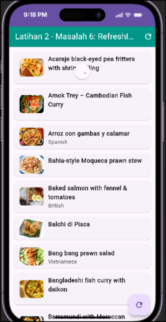

**Gambar 2.6:** RefreshIndicator saat tarik ke bawah untuk refresh data

#### Pembahasan

`RefreshIndicator`:

- **Hanya bekerja** di widget scrollable (`ListView`, `SingleChildScrollView`, dll.)
- Memanggil `onRefresh` saat user menarik layar ke bawah
- Menampilkan **indikator loading** otomatis
- **Catatan:** Tidak akan bekerja jika ditempatkan di widget non-scrollable (contoh: `Center`)


## Kesimpulan

### Ringkasan Temuan

1. **API Dinamis:** Endpoint `filter.php` mengembalikan data berbeda berdasarkan parameter kategori
2. **Error Handling:** Penting untuk membedakan error jaringan (`catch`) vs error server (`statusCode != 200`)
3. **Async Programming:** `await` diperlukan untuk menunggu `Future` selesai dan mengekstrak nilainya
4. **Model Class:** Field harus **nullable** (`String?`) jika API bisa mengembalikan `null`
5. **Null Safety:** Operator `??` mencegah crash saat field JSON adalah `null`
6. **UI Responsif:** `RefreshIndicator` dan `errorBuilder` meningkatkan UX

### Kendala dan Solusi

| Kendala | Solusi |
|---------|--------|
| URL salah menyebabkan 404 | Validasi endpoint di browser terlebih dahulu |
| Data kosong saat offline | Implementasi `try-catch` dan tombol retry |
| Gambar tidak memuat | Gunakan `errorBuilder` untuk fallback |
| Field JSON null | Gunakan nullable type (`String?`) dan default value (`??`) |

### Saran untuk Praktikum Selanjutnya

1. Selalu verifikasi endpoint di browser sebelum coding
2. Implementasikan timeout untuk HTTP request (contoh: 10 detik)
3. Gunakan `FutureBuilder` untuk manajemen state yang lebih bersih
4. Pisahkan code menjadi: model, service, UI (clean architecture)

---

*Laporan ini disusun sebagai bagian dari tugas Praktikum Pemrograman Mobile, Pertemuan 4.*
