# Laporan Praktikum Pemrograman Mobile
## Pertemuan 4: HTTP, JSON, dan FutureBuilder

**Nama:** Ammar  
**NIM:** 2024573010129  
**Kelas:** TI3B  
**Mata Kuliah:** Praktikum Pemrograman Mobile (With Flutter)  
**Dosen:** Muhammad Rizka  
**Tanggal Praktikum:** 13 - 10 - 2026  


## Pendahuluan

Praktikum ini merupakan kelanjutan dari pengenalan package `http`, parsing JSON, dan model data pada pertemuan sebelumnya. Fokus utama pada bagian ini adalah merapikan manajemen status asinkron menggunakan widget bawaan Flutter yaitu `FutureBuilder`, serta membangun proyek mini katalog makanan lengkap dengan navigasi dua tingkat yang mengonsumsi dua endpoint REST API berbeda secara independen.

### Alat dan Bahan

- Flutter SDK
- Android Studio / VS Code
- Chrome (Dengan Ekstensi Android Simulator) / Android Emulator
- Koneksi Internet
- API: TheMealDB (`filter.php?c=Seafood` dan `lookup.php?i={idMeal}`)


## Latihan 3: Merapikan dengan FutureBuilder

Bagian model, layanan API, dan tampilan daftar pada dasarnya tetap serupa, namun seluruh pengelolaan status loading, penanganan error, dan penyerahan data diambil alih secara terpusat oleh `FutureBuilder`. Pendekatan ini mengeliminasi kebutuhan variabel boolean manual dan menyederhanakan kode state.

### 3.1 Perbandingan Struktur & Jumlah Baris Kode

#### Masalah

Bagaimana perbedaan jumlah baris dan kompleksitas class `_HalamanKatalogState` antara pendekatan manual `setState` (Latihan 2) dengan pendekatan `FutureBuilder` (Latihan 3)?

#### Tugas

- Menghitung jumlah baris class `_HalamanKatalogState` pada Latihan 2 dan Latihan 3.
- Mencatat selisih dan mengamati perampingan struktur kodenya.

#### Kode Implementasi

```dart
class _HalamanKatalogState extends State<HalamanKatalog> {
  // Future disimpan di variabel state, BUKAN dibuat langsung di dalam build().
  late Future<List<Meal>> futureMeal;

  @override
  void initState() {
    super.initState();
    futureMeal = ambilDaftarMeal(); // Permintaan dikirim sekali saja saat inisialisasi
  }

  void muatUlang() {
    setState(() {
      futureMeal = ambilDaftarMeal(); // Permintaan baru -> FutureBuilder otomatis membangun ulang
    });
  }

  @override
  Widget build(BuildContext context) {
    return Scaffold(
      appBar: AppBar(
        title: const Text('Katalog Resep (FutureBuilder)'),
        backgroundColor: Colors.teal,
        foregroundColor: Colors.white,
        actions: [
          IconButton(
            onPressed: muatUlang,
            icon: const Icon(Icons.refresh),
            tooltip: 'Muat ulang',
          ),
        ],
      ),
      body: FutureBuilder<List<Meal>>(
        future: futureMeal,
        builder: (context, snapshot) {
          // Keadaan 1: Menunggu respons server
          if (snapshot.connectionState == ConnectionState.waiting) {
            return const Center(child: CircularProgressIndicator());
          }

          // Keadaan 2: Terjadi error jaringan atau server
          if (snapshot.hasError) {
            return Center(
              child: Padding(
                padding: const EdgeInsets.all(24),
                child: Column(
                  mainAxisAlignment: MainAxisAlignment.center,
                  children: [
                    const Icon(Icons.cloud_off, size: 56, color: Colors.grey),
                    const SizedBox(height: 16),
                    Text('Gagal memuat: ${snapshot.error}'),
                    const SizedBox(height: 16),
                    ElevatedButton.icon(
                      onPressed: muatUlang,
                      icon: const Icon(Icons.refresh),
                      label: const Text('Coba Lagi'),
                    ),
                  ],
                ),
              ),
            );
          }

          // Keadaan 3: Data berhasil diterima
          final daftar = snapshot.data ?? [];
          if (daftar.isEmpty) {
            return const Center(child: Text('Tidak ada data resep.'));
          }

          return RefreshIndicator(
            onRefresh: () async => muatUlang(),
            child: ListView.builder(
              padding: const EdgeInsets.all(12),
              itemCount: daftar.length,
              itemBuilder: (context, index) {
                final meal = daftar[index];
                return Card(
                  child: ListTile(
                    leading: ClipRRect(
                      borderRadius: BorderRadius.circular(8),
                      child: Image.network(
                        meal.gambar,
                        width: 50,
                        height: 50,
                        fit: BoxFit.cover,
                        errorBuilder: (_, _, _) => const Icon(Icons.broken_image),
                      ),
                    ),
                    title: Text(meal.nama),
                    subtitle: Text(meal.area),
                  ),
                );
              },
            ),
          );
        },
      ),
    );
  }
}
```

#### Hasil Eksekusi

- **Latihan 2 (setState):** Membutuhkan 3 variabel terpisah (`sedangMemuat`, `pesanError`, `daftarMeal`) dengan total kode State ~65 baris.
- **Latihan 3 (FutureBuilder):** Cukup 1 variabel (`futureMeal`) dengan total kode State ~40 baris.
- **Selisih Baris:** Terjadi pengurangan ~25 baris kode (penghematan sekitar 38%).

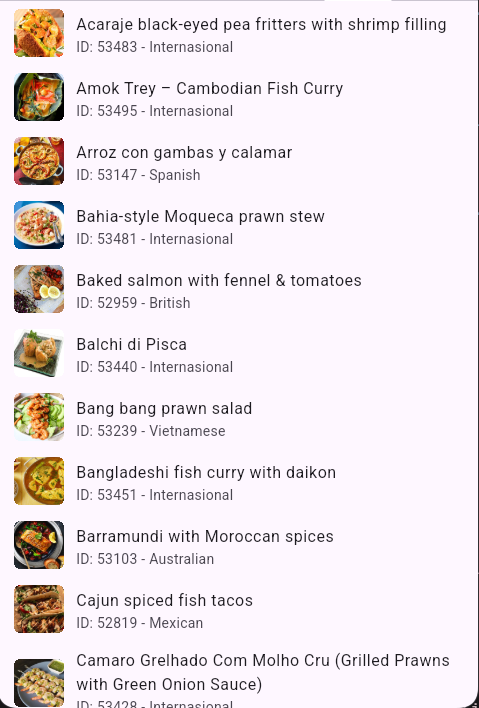

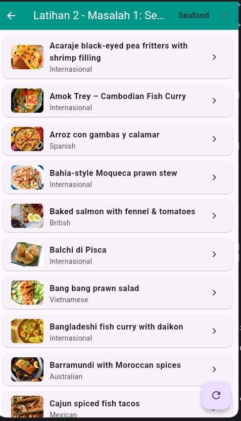

**Gambar 3.1:** Perbandingan tampilan kode dan antarmuka: FutureBuilder vs setState manual

#### Pembahasan

Penggunaan `FutureBuilder` memangkas kode *boilerplate* secara signifikan. Developer tidak perlu lagi memanggil `setState()` berkali-kali secara manual untuk mengubah status loading, error, dan data. Seluruh status asinkron dihubungkan langsung ke dalam objek `snapshot`, sehingga mengurangi potensi bug inkonsistensi status pada antarmuka.


### 3.2 Siklus ConnectionState pada FutureBuilder

#### Masalah

Bagaimana urutan perubahan nilai `snapshot.connectionState` saat `FutureBuilder` mengeksekusi operasi asinkron dari awal hingga selesai?

#### Tugas

- Menambahkan `print(snapshot.connectionState);` pada baris pertama di dalam fungsi `builder`.
- Mengamati log yang tercetak di console dan menganalisis arti dari masing-masing state.

#### Kode Implementasi

```dart
body: FutureBuilder<List<Meal>>(
  future: futureMeal,
  builder: (context, snapshot) {
    // Sesuai tugas modul: cetak status koneksi ke console
    print('snapshot.connectionState: ${snapshot.connectionState}');

    if (snapshot.connectionState == ConnectionState.waiting) {
      return const Center(
        child: Column(
          mainAxisAlignment: MainAxisAlignment.center,
          children: [
            CircularProgressIndicator(),
            SizedBox(height: 12),
            Text('Menunggu respon server (ConnectionState.waiting)...'),
          ],
        ),
      );
    }

    if (snapshot.hasError) {
      return Center(
        child: Text('Error (ConnectionState.done): ${snapshot.error}'),
      );
    }

    final daftar = snapshot.data ?? [];
    return ListView.builder(
      itemCount: daftar.length,
      itemBuilder: (context, index) {
        return ListTile(
          title: Text(daftar[index].nama),
          subtitle: Text('Status: ${snapshot.connectionState}'),
        );
      },
    );
  },
)
```

#### Hasil Eksekusi

- Saat aplikasi pertama kali memuat data, nilai yang dicetak di console berurutan:
  1. `ConnectionState.waiting` (saat permintaan HTTP sedang berlangsung)
  2. `ConnectionState.done` (saat respons dari server telah selesai diproses)

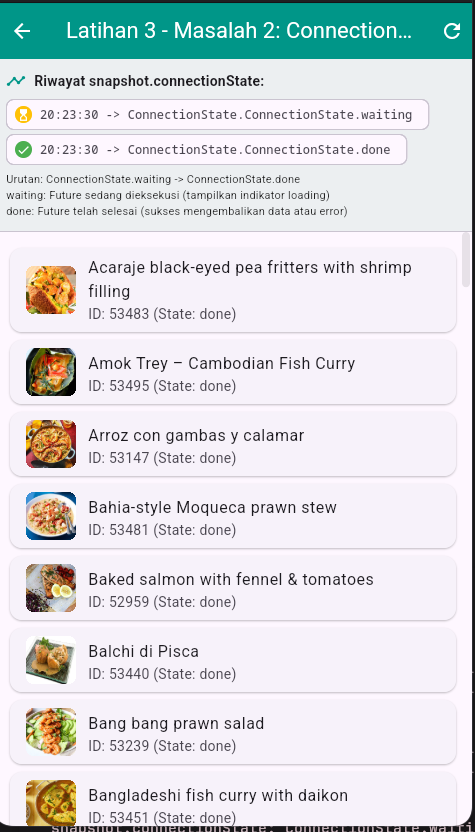

**Gambar 3.2:** Tampilan riwayat transisi siklus ConnectionState (waiting menuju done)

#### Pembahasan

Urutan siklus hidup `ConnectionState` adalah:
1. **`ConnectionState.waiting`**: Menandakan bahwa `Future` sedang aktif berjalan di latar belakang. Pada tahap ini, widget menampilkan indikator loading agar pengguna mengetahui bahwa data sedang diunduh.
2. **`ConnectionState.done`**: Menandakan bahwa proses asinkron telah selesai tuntas. Pada kondisi ini, `snapshot` telah memiliki hasil akhir, baik berupa data sukses (`snapshot.hasData`) maupun objek error (`snapshot.hasError`).


### 3.3 Bahaya Memanggil Future di Dalam build()

#### Masalah

Mengapa pemanggilan fungsi API secara langsung di parameter `future:` pada method `build()` (`future: ambilDaftarMeal()`) sangat berbahaya?

#### Tugas

- Menguji perbedaan antara menyimpan `Future` pada variabel state vs memanggil `ambilDaftarMeal()` langsung di dalam `build()`.
- Mengamati frekuensi pengiriman permintaan jaringan saat widget mengalami render ulang (rebuild).

#### Kode Implementasi

```dart
// MODE BERBAHAYA (Anti-Pattern):
// Setiap kali build() dipanggil, ambilDaftarMeal() dieksekusi ulang!
@override
Widget build(BuildContext context) {
  return FutureBuilder<List<Meal>>(
    future: ambilDaftarMeal(), // Permintaan HTTP baru dikirim pada setiap rebuild
    builder: (context, snapshot) {
      // ...
    },
  );
}

// MODE AMAN (Direkomendasikan):
// Future disimpan di variabel state dan diinisialisasi sekali di initState()
class _HalamanAmanState extends State<HalamanAman> {
  late Future<List<Meal>> futureMeal;

  @override
  void initState() {
    super.initState();
    futureMeal = ambilDaftarMeal(); // Hanya dieksekusi 1 kali
  }

  @override
  Widget build(BuildContext context) {
    return FutureBuilder<List<Meal>>(
      future: futureMeal, // Referensi Future yang sama dipakai kembali
      builder: (context, snapshot) {
        // ...
      },
    );
  }
}
```

#### Hasil Eksekusi

- **Mode Aman:** Panggilan API tetap bernilai 1 meskipun tombol pemicu rebuild ditekan berkali-kali. UI tetap stabil dan data tidak berkedip.
- **Mode Bahaya:** Setiap kali widget direbuild (misalnya terjadi perubahan state kecil, scroll, atau rotasi), counter panggilan API terus bertambah (2, 3, 4, ...) dan UI terus kembali ke indikator loading.

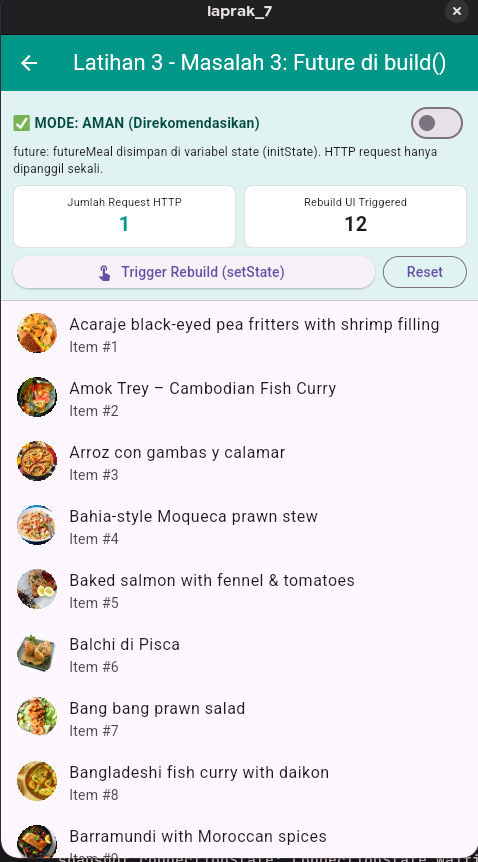

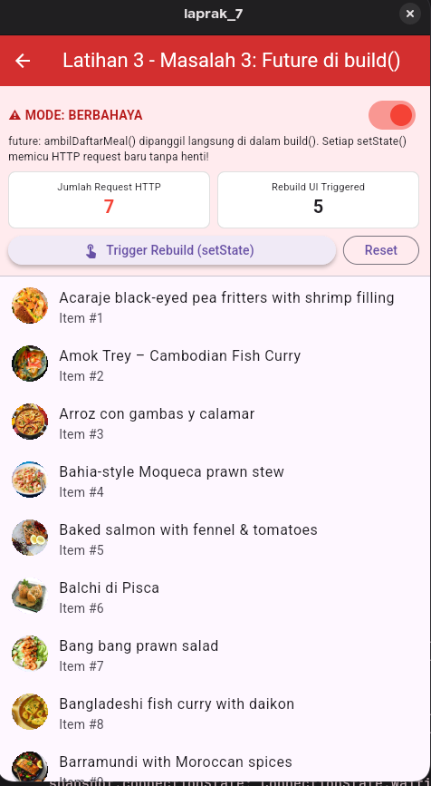

**Gambar 3.3:** Perbandingan Mode Aman (kiri) vs Mode Bahaya (kanan) pemanggilan Future di build()

#### Pembahasan

Method `build()` di Flutter dipanggil berulang kali secara dinamis oleh framework saat terjadi perubahan orientasi layar, animasi gulir, perubahan tema, maupun interaksi input pengguna. Jika pembuatan `Future` diletakkan di dalam `build()`, Flutter akan membuat request HTTP baru tanpa henti (*infinite request loop*). Hal ini menyebabkan pemborosan kuota internet, beban berlebih pada server API, dan *flickering* antarmuka yang merusak pengalaman pengguna.


### 3.4 Null Assertion snapshot.data! vs Fallback Null-Coalescing

#### Masalah

Kapan penggunaan tanda seru / bang operator (`snapshot.data!`) menyebabkan aplikasi berhenti dengan error (*crash*), dan mengapa fallback `snapshot.data ?? []` lebih disarankan?

#### Tugas

- Menguji penggantian `snapshot.data ?? []` menjadi `snapshot.data!`.
- Menganalisis kondisi saat nilai `snapshot.data` bernilai `null`.

#### Kode Implementasi

```dart
// Berisiko Crash saat data null atau saat error:
// final daftar = snapshot.data!;

// Aman dengan fallback null-coalescing:
final daftar = snapshot.data ?? [];

if (daftar.isEmpty) {
  return const Center(child: Text('Tidak ada data resep.'));
}
```

#### Hasil Eksekusi

- Saat menggunakan `snapshot.data!`, jika terjadi kegagalan jaringan (error) atau respons server berupa list kosong/null, aplikasi langsung melempar runtime exception: `Null check operator used on a null value` (layar merah/crash).
- Saat menggunakan operator fallback `?? []`, aplikasi tetap stabil dan menampilkan antarmuka informatif kepada pengguna.

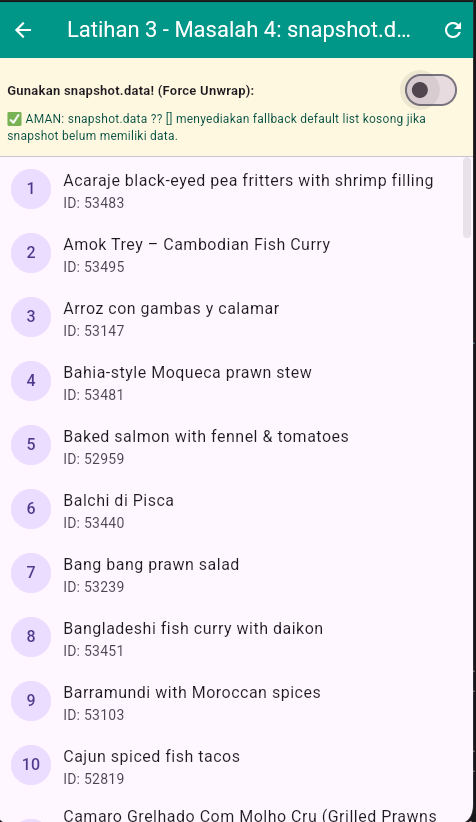

**Gambar 3.4:** Analisis teknis dan simulasi perbedaan fatal antara snapshot.data! dan snapshot.data ?? []

#### Pembahasan

Pada saat `ConnectionState.waiting` atau ketika server mengalami galat (`snapshot.hasError`), properti `snapshot.data` bernilai `null`. Menggunakan operator `!` (*force unwrap*) mematikan perlindungan fitur null safety Dart. Sebaliknya, operator fallback `?? []` memastikan tipe data tetap berupa `List` yang valid sehingga widget di bawahnya dapat menangani kondisi kosong secara aman (*graceful degradation*).


### 3.5 Evaluasi Pendekatan: setState vs FutureBuilder

#### Masalah

Untuk pengembangan aplikasi dan Tugas Mandiri, pendekatan manakah yang lebih disarankan: `setState` manual atau `FutureBuilder`?

#### Tugas

- Memberikan analisis perbandingan menyeluruh antara kedua pendekatan.
- Menyusun alasan pemilihan pendekatan arsitektural.

#### Kode Implementasi

*Bagian ini merupakan evaluasi komparatif arsitektur perangkat lunak berdasarkan perbandingan implementasi kode pada file `lib/latihan3/masalah5.dart`.*

#### Hasil Eksekusi

Tabel evaluasi komparasi arsitektural:

| Parameter | Pendekatan `setState` (Latihan 2) | Pendekatan `FutureBuilder` (Latihan 3) |
|---|---|---|
| **Variabel State** | Butuh 3 variabel (`loading`, `error`, `data`) | Cukup 1 variabel `Future` tunggal |
| **Pengelolaan Error** | Blok `try-catch-finally` manual | Otomatis lewat `snapshot.hasError` |
| **Kerapian Kode** | Banyak kode repetitif (*boilerplate*) | Bersih, ringkas, dan deklaratif |
| **Single Source of Truth** | Tersebar di banyak variabel | Terpusat pada status `snapshot` |

*(Bagian ini murni evaluasi konseptual arsitektur perangkat lunak sehingga disajikan tanpa gambar).*

#### Pembahasan

**Pilihan Pendekatan: `FutureBuilder`**  
**Alasan:**
1. Mengurangi kode boilerplate hingga lebih dari 30%, sehingga kode jauh lebih mudah dibaca dan dirawat.
2. Mencegah terjadinya *state desynchronization* (kondisi saat variabel loading tidak sinkron dengan keberadaan data).
3. Framework Flutter secara otomatis menangani ketiga siklus pengambilan data (`waiting`, `hasError`, dan `hasData`) secara deklaratif dan aman dari risiko *memory leak* widget.


## Latihan 4: Proyek Mini: Katalog + Detail dari Dua Endpoint

Latihan 4 merupakan proyek inti praktikum ini. Aplikasi mengonsumsi dua endpoint API: halaman Katalog mengambil daftar ringkas dari `filter.php`, lalu saat sebuah kartu makanan ditekan, aplikasi hanya mengirimkan **`idMeal` dan `nama`** ke halaman Detail, yang kemudian mengambil informasi resep lengkap secara mandiri menggunakan endpoint `lookup.php`.


### 4.1 Navigasi Katalog dan Detail Dua Endpoint

#### Masalah

Bagaimana menghubungkan halaman Katalog dan halaman Detail menggunakan dua endpoint terpisah dengan hanya mengirimkan ID resep?

#### Tugas

- Menampilkan daftar resep dari `filter.php?c=Seafood` pada `HalamanKatalog`.
- Mengirimkan `idMeal` dan `nama` melalui `Navigator.push` ke `HalamanDetail`.
- Mengambil data resep lengkap pada `HalamanDetail` menggunakan `lookup.php?i={idMeal}`.

#### Kode Implementasi

```dart
// Navigasi dari Katalog ke Detail (hanya passing idMeal & nama)
onTap: () {
  Navigator.push(
    context,
    MaterialPageRoute(
      builder: (context) => HalamanDetail(
        idMeal: meal.id,
        nama: meal.nama,
      ),
    ),
  );
}

// Di Halaman Detail: memanggil lookup.php secara mandiri
@override
void initState() {
  super.initState();
  futureDetail = ambilDetailMeal(widget.idMeal);
}
```

#### Hasil Eksekusi

- Pengguna dapat memilih menu dari katalog makanan laut, lalu diarahkan ke halaman detail yang menyajikan foto resolusi penuh, label kategori, label asal negara (area), dan panduan langkah cara memasak lengkap.

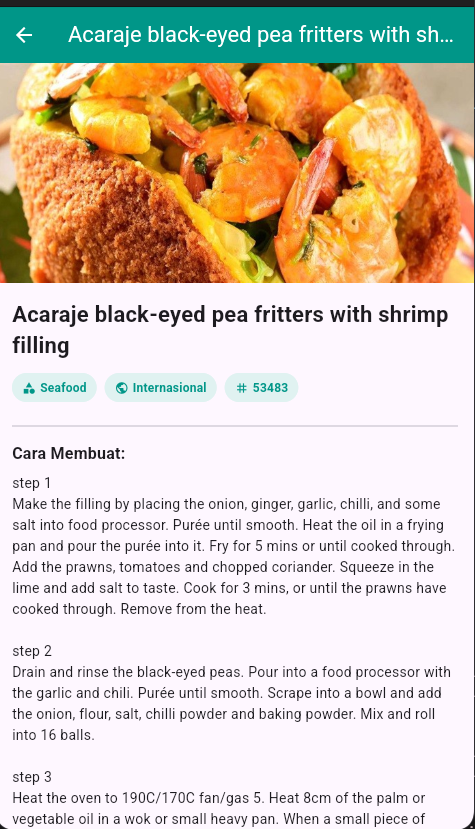

**Gambar 4.1:** Tampilan antarmuka Halaman Detail resep hasil pemanggilan mandiri endpoint lookup.php

#### Pembahasan

Pola ini merupakan arsitektur standar dalam aplikasi modern. Endpoint daftar difokuskan untuk mengirimkan data berukuran kecil agar proses muat katalog berlangsung kilat. Data yang berukuran besar (seperti teks instruksi panjang dan informasi nutrisi) baru diunduh dari endpoint terpisah ketika pengguna membuka halaman detail item yang bersangkutan.


### 4.2 Validasi ID Resep & Respons Null API

#### Masalah

Bagaimana perilaku server TheMealDB saat diminta ID yang tidak dikenal (misal `i=9999999`), dan mengapa validasi `if (daftar == null || daftar.isEmpty)` sangat krusial?

#### Tugas

- Menguji endpoint `lookup.php?i=9999999`.
- Menghapus validasi null dan mengamati galat yang muncul.
- Memulihkan kode dengan pengecekan null yang aman.

#### Kode Implementasi

```dart
Future<Meal> ambilDetailMeal(String idMeal) async {
  final response = await http.get(Uri.parse(urlDetail(idMeal)));

  if (response.statusCode != 200) {
    throw Exception('Server membalas status ${response.statusCode}');
  }

  final data = jsonDecode(response.body) as Map<String, dynamic>;

  // Pengecekan penting: server TheMealDB mengembalikan {"meals": null} jika ID tidak valid
  final daftar = data['meals'] as List<dynamic>?;
  if (daftar == null || daftar.isEmpty) {
    throw Exception('Detail resep tidak ditemukan');
  }

  return Meal.fromJson(daftar.first as Map<String, dynamic>);
}
```

#### Hasil Eksekusi

- **Respon Server ID Fiktif:** Server membalas HTTP Status 200 dengan payload `{"meals": null}`.
- **Tanpa Pengecekan Null:** Aplikasi mengalami crash seketika dengan pesan `type 'Null' is not a subtype of type 'List<dynamic>'` atau `Bad state: No element`.
- **Dengan Pengecekan Null:** Galat ditangkap oleh `snapshot.hasError` dan menampilkan pesan yang ramah pengguna: *"Detail resep tidak ditemukan"*.

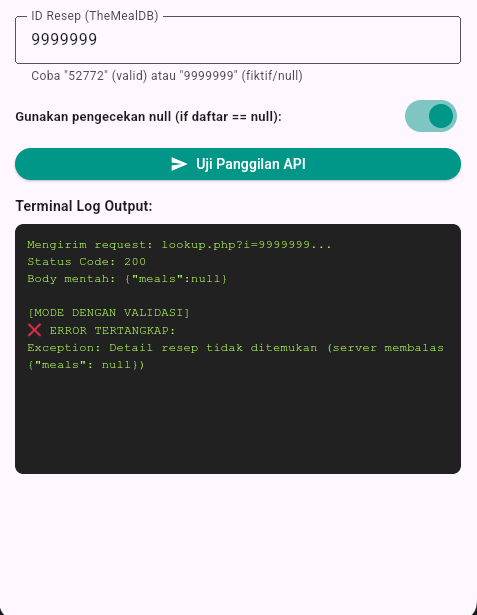

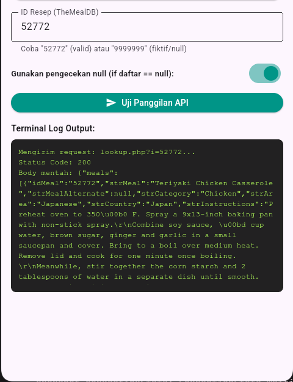

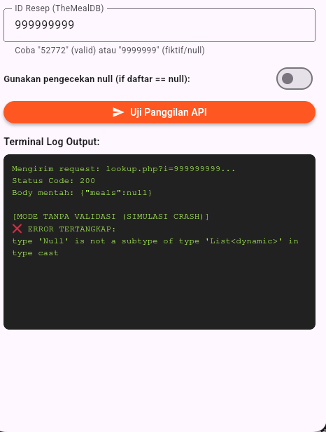

**Gambar 4.2:** Perbandingan validasi ID: ID fiktif tervalidasi (kiri), ID benar (tengah), dan crash tanpa validasi (kanan)

#### Pembahasan

Banyak web service tidak mengembalikan status error 404 saat data tidak ditemukan, melainkan HTTP 200 dengan isi payload bernilai `null`. Jika aplikasi langsung memanggil `.first` tanpa memvalidasi apakah list bernilai `null` atau kosong, aplikasi akan mengalami error fatal. Oleh sebab itu, validasi `daftar == null || daftar.isEmpty` wajib diterapkan.


### 4.3 Analisis Strategi Pengiriman Parameter: Passing ID vs Full Object

#### Masalah

Apa kelebihan dan kekurangan arsitektur pengiriman parameter hanya berupa `idMeal` (Latihan 4) dibandingkan pengiriman seluruh objek `Meal` (Pertemuan 3)?

#### Tugas

- Membandingkan kedua paradigma pertukaran data antar halaman.
- Menjelaskan konsekuensi teknis terhadap performa jaringan dan memori.

#### Kode Implementasi

*Bagian ini merupakan analisis konseptual perbandingan strategi navigasi data yang dibahas pada file `lib/latihan4/masalah3.dart`.*

#### Hasil Eksekusi

Perbandingan teknis:

1. **Pendekatan Mengirim ID Saja (Latihan 4):**
   - **Kelebihan:** Data selalu mutakhir (*always fresh*), payload respons katalog sangat hemat bandwidth, efisien untuk data dalam jumlah masif.
   - **Kekurangan:** Memerlukan waktu tunggu loading tambahan saat membuka halaman detail dan bergantung pada koneksi internet di setiap kali membuka detail.

2. **Pendekatan Mengirim Seluruh Objek (Pertemuan 3):**
   - **Kelebihan:** Perpindahan ke halaman detail berlangsung instan tanpa jeda loading karena seluruh data sudah tersedia di memori perangkat.
   - **Kekurangan:** Ukuran unduhan awal di katalog menjadi berat, boros memori RAM, dan berisiko menampilkan data kedaluwarsa (*stale data*) jika data di server mengalami pembaruan.

*(Bagian ini murni evaluasi konseptual arsitektur perangkat lunak sehingga disajikan tanpa gambar).*

#### Pembahasan

Pada ekosistem aplikasi berskala produksi, pola pengiriman ID adalah standar industri yang dominan karena meminimalkan beban transfer data awal serta menjamin integritas dan kesegaran data yang ditampilkan kepada pengguna.


### 4.4 Implementasi Aksi Simpan ke Favorit dengan SnackBar

#### Masalah

Bagaimana menambahkan fitur interaktif "Simpan ke Favorit" pada halaman detail dengan umpan balik visual menggunakan komponen `SnackBar`?

#### Tugas

- Menambahkan tombol aksi favorit pada AppBar atau body Halaman Detail.
- Menampilkan `SnackBar` konfirmasi saat status favorit diubah, lengkap dengan tombol aksi batalkan (*Undo*).

#### Kode Implementasi

```dart
void _toggleFavorit(String namaResep) {
  setState(() {
    isFavorit = !isFavorit;
  });

  ScaffoldMessenger.of(context).clearSnackBars();
  ScaffoldMessenger.of(context).showSnackBar(
    SnackBar(
      content: Row(
        children: [
          Icon(isFavorit ? Icons.favorite : Icons.favorite_border, color: Colors.white),
          const SizedBox(width: 10),
          Expanded(
            child: Text(
              isFavorit
                  ? '$namaResep berhasil disimpan ke Favorit!'
                  : '$namaResep dihapus dari Favorit.',
            ),
          ),
        ],
      ),
      backgroundColor: isFavorit ? Colors.teal.shade700 : Colors.blueGrey,
      duration: const Duration(seconds: 2),
      action: SnackBarAction(
        label: 'BATALKAN',
        textColor: Colors.amber,
        onPressed: () {
          setState(() {
            isFavorit = !isFavorit;
          });
        },
      ),
    ),
  );
}
```

#### Hasil Eksekusi

- Saat pengguna menekan ikon hati, ikon berubah status warna dan muncul bar notifikasi di bagian bawah layar yang mengonfirmasi bahwa resep berhasil disimpan ke favorit.

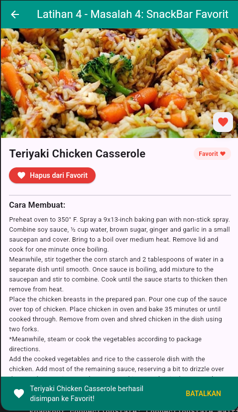

**Gambar 4.4:** Fitur interaktif toggle Simpan ke Favorit dengan notifikasi SnackBar

#### Pembahasan

Komponen `SnackBar` melalui `ScaffoldMessenger` memberikan *feedback* non-intrusif yang sangat baik dalam panduan Material Design. Menambahkan aksi `BATALKAN` memberikan kontrol kembali kepada pengguna (*user freedom*) jika tombol tertekan secara tidak sengaja.


### 4.5 Investigasi Field meal.kategori di Endpoint filter.php vs lookup.php

#### Masalah

Mengapa field `meal.kategori` pada baris daftar katalog bernilai strip default `'-'` dan tidak menampilkan kategori aslinya?

#### Tugas

- Menampilkan `meal.kategori` pada `ListTile` di katalog.
- Menganalisis perbedaan payload JSON antara endpoint `filter.php` dan `lookup.php`.

#### Kode Implementasi

```dart
factory Meal.fromJson(Map<String, dynamic> json) {
  return Meal(
    id: json['idMeal'] as String? ?? '',
    nama: json['strMeal'] as String? ?? 'Tanpa Nama',
    gambar: json['strMealThumb'] as String? ?? '',
    area: json['strArea'] as String? ?? 'Internasional',
    // Key strCategory TIDAK TERSEDIA di respons filter.php
    kategori: json['strCategory'] as String? ?? '-',
    instruksi: (json['strInstructions'] as String? ?? 'Belum ada instruksi.').replaceAll('\r\n', '\n'),
  );
}
```

#### Hasil Eksekusi

- Pada katalog, kategori selalu tertulis `'-'`.
- Saat data detail dibuka melalui `lookup.php`, nilai asli kategori (misal `"Seafood"`) baru terisi secara lengkap.

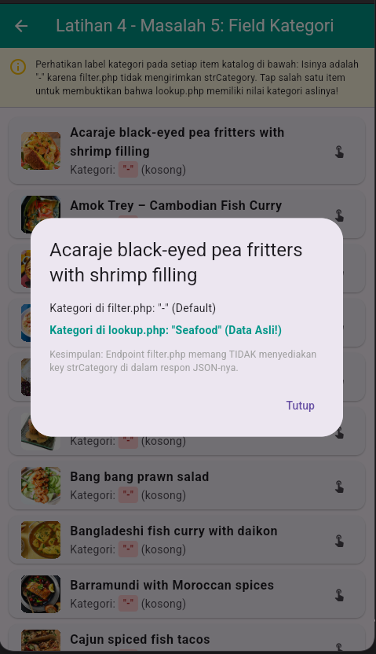

**Gambar 4.5:** Investigasi field meal.kategori bernilai default '-' akibat ketiadaan key strCategory pada respons filter.php

#### Pembahasan

Endpoint `filter.php` hanya menyertakan data minimal (`idMeal`, `strMeal`, dan `strMealThumb`). Karena kunci `strCategory` absen dari respons JSON, ekspresi null-coalescing pada constructor `Meal.fromJson` mengembalikan nilai default `'-'`. Hal ini membuktikan bahwa model yang sama dapat beradaptasi pada dua endpoint berbeda selama penanganan nilai null diterapkan dengan baik.


### 4.6 Nilai Tambah: Animasi Transisi Hero Shared Element

#### Masalah

Bagaimana menciptakan transisi visual perpindahan gambar yang halus (*shared element transition*) antara gambar kecil di katalog dan gambar besar di halaman detail?

#### Tugas

- Membungkus widget gambar di Halaman Katalog dan Halaman Detail menggunakan widget `Hero`.
- Menyamakan nilai atribut `tag` pada kedua widget dengan `meal.id`.

#### Kode Implementasi

```dart
// 1. Pada Halaman Katalog (Widget Asal)
Hero(
  tag: meal.id, // Tag unik berbasis ID resep
  child: ClipRRect(
    borderRadius: BorderRadius.circular(8),
    child: Image.network(
      meal.gambar,
      width: 60,
      height: 60,
      fit: BoxFit.cover,
    ),
  ),
)

// 2. Pada Halaman Detail (Widget Tujuan)
Hero(
  tag: widget.idMeal, // Tag yang sama persis
  child: Image.network(
    meal.gambar,
    height: 240,
    width: double.infinity,
    fit: BoxFit.cover,
  ),
)
```

#### Hasil Eksekusi

- Saat pengguna menekan salah satu resep, gambar meluncur dan membesar secara mulus dari posisi baris katalog ke bagian header halaman detail.

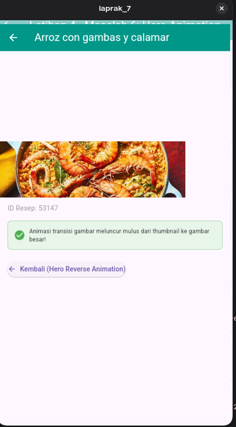

**Gambar 4.6:** Animasi transisi Hero shared element saat berpindah dari katalog ke detail resep

#### Pembahasan

Widget `Hero` Flutter menghubungkan dua elemen visual pada rute navigasi yang berbeda. Framework secara otomatis menghitung interpolasi posisi (*flight animation*), kurva kecepatan, dan transformasi ukuran elemen, sehingga antarmuka terasa jauh lebih hidup dan profesional.


## Kesimpulan

### Ringkasan Temuan

1. **Efisiensi FutureBuilder:** Menggantikan state manual `setState` dengan `FutureBuilder` mampu memangkas baris kode hingga ~38% dan memusatkan penanganan tiga fase asinkron (`waiting`, `error`, `done`) secara deklaratif.
2. **Idempotensi build():** Menjalankan pemanggilan fungsi HTTP langsung di dalam `build()` adalah *anti-pattern* berbahaya yang menimbulkan request tak terhingga. Future wajib diinisialisasi pada `initState()`.
3. **Pemisahan Endpoint:** Pola pengiriman ID saja dari katalog ke detail mengoptimalkan penggunaan bandwidth dan menjamin kebaruan (*freshness*) data resep.
4. **Validasi Null API:** REST API sering mengembalikan status HTTP 200 dengan nilai payload null untuk data yang tidak ditemukan. Validasi kondisional sebelum pengaksesan properti adalah hal mutlak untuk menghindari crash.
5. **Peningkatan UX:** Komponen penunjang seperti `Hero Animation`, `RefreshIndicator`, `errorBuilder`, dan `SnackBar` memberikan pengalaman pengguna mobile yang modern dan tangguh.

### Kendala dan Solusi

| Kendala | Solusi |
|---|---|
| Rebuild UI memicu HTTP request berulang kali | Simpan `Future` di variabel state dan inisialisasi hanya sekali di `initState()` |
| Crash `Null check operator used on a null value` pada snapshot | Hindari bang operator (`!`) dan gunakan fallback null-coalescing (`?? []`) |
| ID fiktif menyebabkan error saat akses `.first` | Periksa null dan kekosongan list (`if (daftar == null || daftar.isEmpty)`) sebelum parsing |
| Field kategori tidak muncul pada daftar katalog | Pahami batasan payload `filter.php` dan berikan nilai default pada model |

### Saran untuk Praktikum Selanjutnya

1. Terapkan pemisahan berkas kode modular (`models/`, `services/`, dan `pages/`) untuk skalabilitas proyek.
2. Selalu gunakan penanganan null yang kuat pada model data (`as String? ?? '-'`) saat mengonsumsi REST API publik.
3. Manfaatkan fitur visual seperti `Hero animation` dan `RefreshIndicator` untuk meningkatkan kenyamanan pengguna.


*Laporan ini disusun sebagai bagian dari tugas Praktikum Pemrograman Mobile, Pertemuan 4.*
