# Laporan Praktikum Pemrograman Mobile
## Pertemuan 5: Database Online dengan Supabase

**Nama:** Ammar  
**NIM:** 2024573010129  
**Kelas:** TI3B  
**Mata Kuliah:** Praktikum Pemrograman Mobile (With Flutter)  
**Dosen:** Muhammad Rizka  
**Tanggal Praktikum:** 20 - 10 - 2026

---

## Pendahuluan

Praktikum Pertemuan 5 merupakan kelanjutan dari Pertemuan 4 yang hanya mengonsumsi API publik menggunakan package `http`. Pada pertemuan sebelumnya aplikasi hanya dapat membaca data dari server milik orang lain. Pada praktikum ini aplikasi mulai mengelola database milik sendiri menggunakan **Supabase**, sebuah layanan *Backend as a Service* (BaaS) yang dibangun di atas **PostgreSQL**.

Supabase menyediakan Data API (PostgREST) sehingga aplikasi Flutter dapat melakukan operasi database tanpa menulis backend sendiri. Operasi yang dipelajari pada pertemuan ini adalah **Create, Read, Update, Delete (CRUD)**, dengan penekanan pada Latihan 1 yaitu operasi **Read** menggunakan `select()`.

Laporan ini secara khusus membahas **Latihan 1: Dari Dashboard ke Aplikasi — SELECT Pertama**. Fokusnya adalah membuktikan bahwa data yang tampil di aplikasi benar-benar berasal dari database cloud, bukan dari data statis di dalam kode.

### Alat dan Bahan

- Flutter SDK 3.47.5
- Package `supabase_flutter` 2.18.3
- Visual Studio Code / Android Studio
- Supabase (project gratis)
- Browser Chrome dan desktop Linux sebagai dua perangkat pengujian
- Koneksi internet

---

## Persiapan

### Pembuatan Project Supabase

Project Supabase dibuat melalui dashboard dengan nama project `ammarramma's Project`, region **Asia-Pacific**, dan opsi **Enable Data API** aktif. Setelah project selesai dibuat, URL project dan *publishable key* dicatat untuk dimasukkan ke aplikasi.

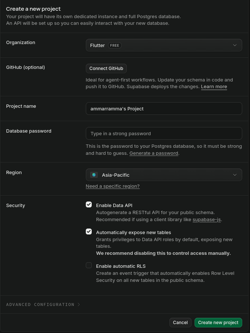

**Gambar 1:** Form pembuatan project Supabase.

### Skrip SQL Tabel Menu {.page-break}

Skrip berikut dijalankan sekali melalui **SQL Editor** Supabase. Skrip ini membuat tabel `menu`, mengisi lima data contoh, mengaktifkan RLS, membuat policy, dan memberikan hak akses Data API.

```sql
-- 1. Tabel utama
create table if not exists public.menu (
  id          bigint primary key generated always as identity,
  nama        text not null,
  kategori    text not null default 'Makanan',
  harga       integer not null default 0,
  deskripsi   text,
  tersedia    boolean not null default true,
  dibuat_pada timestamptz not null default now()
);

-- 2. Data contoh
insert into public.menu (nama, kategori, harga, deskripsi) values
  ('Mie Aceh',           'Makanan', 25000, 'Mie tebal dengan kuah bumbu rempah khas Aceh'),
  ('Kopi Sanger',        'Minuman', 15000, 'Kopi robusta diseduh dengan susu kental manis'),
  ('Ayam Tangkap',       'Makanan', 35000, 'Ayam goreng dengan daun kari dan daun pandan'),
  ('Pisang Goreng Keju', 'Camilan', 12000, 'Pisang goreng renyah dengan topping keju parut'),
  ('Es Timun Serut',     'Minuman', 10000, 'Minuman segar dari timun serut dan jeruk nipis');

-- 3. Aktifkan Row Level Security
alter table public.menu enable row level security;

-- 4. Policy untuk praktikum
drop policy if exists "menu_baca_publik"  on public.menu;
drop policy if exists "menu_tambah_publik" on public.menu;
drop policy if exists "menu_ubah_publik"  on public.menu;
drop policy if exists "menu_hapus_publik" on public.menu;

create policy "menu_baca_publik"
  on public.menu for select to anon, authenticated using (true);

create policy "menu_tambah_publik"
  on public.menu for insert to anon, authenticated with check (true);

create policy "menu_ubah_publik"
  on public.menu for update to anon, authenticated using (true) with check (true);

create policy "menu_hapus_publik"
  on public.menu for delete to anon, authenticated using (true);

-- 5. Hak akses Data API
grant select, insert, update, delete on public.menu to anon;
grant select, insert, update, delete on public.menu to authenticated;

-- 6. Izin sequence
grant usage, select on all sequences in schema public to anon;
grant usage, select on all sequences in schema public to authenticated;
```

Skrip lengkap disimpan pada file `supabase/setup.sql` di dalam project.

### Dependensi {.page-break}

Package Supabase ditambahkan melalui perintah berikut:

```bash
flutter pub add supabase_flutter
```

Sehingga `pubspec.yaml` memuat dependensi:

```yaml
dependencies:
  flutter:
    sdk: flutter
  supabase_flutter: ^2.18.3
```

### Konfigurasi Aplikasi

Kredensial dimasukkan ke `lib/config.dart`. File ini hanya memuat **publishable key**, bukan *secret key* atau *service_role key*.

```dart
// lib/config.dart
const String supabaseUrl = 'https://xxxxxxxxxxxx.supabase.co';
const String supabaseKey = 'salin-publishable-key-anda-di-sini';
```

File `lib/config.dart` juga ditambahkan ke `.gitignore` agar tidak ikut ter-commit. Sebagai contoh untuk pengumpulan, disediakan `lib/config.example.dart`.

### Struktur Project

```text
laprak_9/
├── lib/
│   ├── config.dart
│   ├── config.example.dart
│   ├── main.dart
│   ├── latihan1/
│   │   ├── masalah1.dart ... masalah6.dart
│   ├── models/
│   │   └── menu_item.dart
│   ├── services/
│   │   └── menu_service.dart
│   ├── utils/
│   │   └── formatter.dart
│   └── widgets/
│       └── halaman_daftar_menu.dart
├── supabase/
│   └── setup.sql
└── pubspec.yaml
```

`main.dart` berfungsi sebagai router yang menampilkan enam tugas Latihan 1. Inisialisasi Supabase dilakukan sebelum aplikasi dijalankan.

```dart
Future<void> main() async {
  WidgetsFlutterBinding.ensureInitialized();

  await Supabase.initialize(
    url: supabaseUrl,
    publishableKey: supabaseKey,
  );

  runApp(const PraktikumRouter());
}
```

---

## Latihan 1: Dari Dashboard ke Aplikasi

Latihan 1 bertujuan membuktikan bahwa data yang tampil di aplikasi benar-benar berasal dari tabel `menu` di Supabase. Seluruh tugas pada bagian ini menggunakan satu halaman daftar yang sama, dengan beberapa variasi pengurutan dan tampilan kolom. Perubahan data dilakukan melalui **Table Editor**, sedangkan aplikasi hanya membaca ulang data melalui tombol refresh.

### 1.1 SELECT Pertama

#### Masalah

Bagaimana membuktikan bahwa data yang ditampilkan aplikasi benar-benar berasal dari database Supabase, bukan data yang ditulis langsung di dalam kode?

#### Tugas

- Menampilkan isi tabel `menu` pada aplikasi.
- Membandingkan data aplikasi dengan isi **Table Editor**.
- Mencatat harga `Mie Aceh` yang tampil dan menjelaskan mengapa nilainya demikian.

#### Kode Implementasi

Model `MenuItem` mengubah setiap baris hasil query menjadi objek Dart.

```dart
class MenuItem {
  final int id;
  final String nama;
  final String kategori;
  final int harga;
  final String deskripsi;
  final bool tersedia;
  final DateTime? dibuatPada;

  factory MenuItem.fromJson(Map<String, dynamic> json) {
    return MenuItem(
      id: (json['id'] as num?)?.toInt() ?? 0,
      nama: json['nama'] as String? ?? '-',
      kategori: json['kategori'] as String? ?? 'Lainnya',
      harga: (json['harga'] as num?)?.toInt() ?? 0,
      deskripsi: json['deskripsi'] as String? ?? '',
      tersedia: json['tersedia'] as bool? ?? true,
      dibuatPada: DateTime.tryParse(json['dibuat_pada'] as String? ?? ''),
    );
  }
}
```

Query `SELECT` dijalankan melalui service berikut.

```dart
Future<List<MenuItem>> ambilDaftarMenu({bool urutMenurun = false}) async {
  final data = await Supabase.instance.client
      .from('menu')
      .select()
      .order('nama', ascending: !urutMenurun);

  return data.map((baris) => MenuItem.fromJson(baris)).toList();
}
```

Hasil query ditampilkan menggunakan `FutureBuilder`. `Future` disimpan di dalam state dan dibuat di `initState`, bukan di dalam `build()`.

```dart
late Future<List<MenuItem>> _futureMenu;

@override
void initState() {
  super.initState();
  _futureMenu = _ambilData();
}

FutureBuilder<List<MenuItem>>(
  future: _futureMenu,
  builder: (context, snapshot) {
    if (snapshot.connectionState == ConnectionState.waiting) {
      return const Center(child: CircularProgressIndicator());
    }
    if (snapshot.hasError) {
      return _tampilanError('${snapshot.error}', _muatUlang);
    }
    final daftar = snapshot.data ?? const <MenuItem>[];
    // ... menampilkan daftar pada ListView
  },
)
```

#### Hasil Eksekusi

Setelah skrip SQL dijalankan, verifikasi REST ke endpoint `/rest/v1/menu` mengembalikan **HTTP 200** dengan **lima baris** data. Aplikasi kemudian menampilkan data dari tabel `menu` sebagai berikut:

| ID | Nama | Kategori | Harga |
|---|---|---|---|
| 3 | Ayam Tangkap | Makanan | Rp 35.000 |
| 5 | Es Timun Serut | Minuman | Rp 10.000 |
| 2 | Kopi Sanger | Minuman | Rp 15.000 |
| 1 | Mie Aceh | Makanan | Rp 25.000 |
| 4 | Pisang Goreng Keju | Camilan | Rp 12.000 |

Harga `Mie Aceh` yang tampil adalah **Rp 25.000** karena nilai tersebut adalah nilai yang tersimpan di tabel `menu` pada saat pengujian. Aplikasi tidak menyimpan salinan data secara lokal, sehingga jika nilai di Table Editor diubah menjadi `27000` lalu tombol refresh ditekan, aplikasi akan menampilkan **Rp 27.000**.

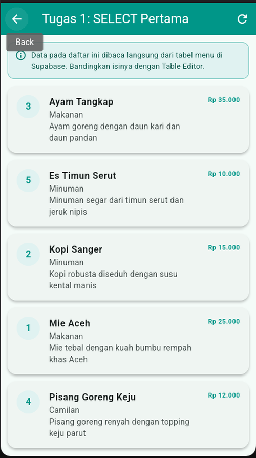

**Gambar 2:** Lima data menu yang dibaca langsung dari tabel `menu` di Supabase.

#### Pembahasan

Data yang tampil berasal dari alur berikut:

```text
Table Editor / SQL Editor
        ↓
PostgreSQL (tabel menu)
        ↓
Data API (PostgREST)
        ↓
supabase_flutter .select()
        ↓
MenuItem.fromJson()
        ↓
FutureBuilder → ListView
```

Aplikasi tidak memiliki data cadangan di dalam kode. Setiap kali fungsi `ambilDaftarMenu()` dipanggil, aplikasi mengirim permintaan HTTP ke Data API Supabase, lalu mengubah respons JSON menjadi `List<MenuItem>`. Karena itu, isi aplikasi selalu mengikuti kondisi tabel di database pada saat query dijalankan. Pengurutan A–Z juga dilakukan oleh server melalui `.order('nama', ascending: true)`.

---

### 1.2 Perubahan dari Table Editor

#### Masalah

Apakah perubahan yang dilakukan langsung dari dashboard Supabase dapat muncul di aplikasi tanpa mengubah kode program?

#### Tugas

- Mengubah nama salah satu menu melalui Table Editor.
- Menekan tombol refresh pada aplikasi.
- Menjelaskan alur data dari Table Editor sampai ke layar aplikasi.

#### Kode Implementasi

Tombol refresh memanggil `_muatUlang()`. Method ini membuat `Future` baru sehingga `FutureBuilder` menjalankan query `SELECT` terbaru.

```dart
void _muatUlang() {
  setState(() {
    _futureMenu = _ambilData();
  });
}
```

Selain tombol di AppBar, daftar juga mendukung *pull-to-refresh*:

```dart
RefreshIndicator(
  onRefresh: _tarikUntukMuatUlang,
  child: ListView.builder(
    padding: const EdgeInsets.all(12),
    itemCount: daftar.length,
    itemBuilder: (context, index) => _kartuMenu(daftar[index]),
  ),
)
```

#### Hasil Eksekusi

Nama menu **Ayam Tangkap** diubah menjadi **Naga Tangkap** melalui Table Editor. Sebelum refresh, aplikasi masih menampilkan **Ayam Tangkap**. Setelah tombol refresh ditekan, aplikasi menampilkan **Naga Tangkap**.

Karena daftar diurutkan berdasarkan nama, posisi baris juga berubah: **Naga Tangkap** berpindah ke bawah **Mie Aceh**, mengikuti urutan abjad yang baru.

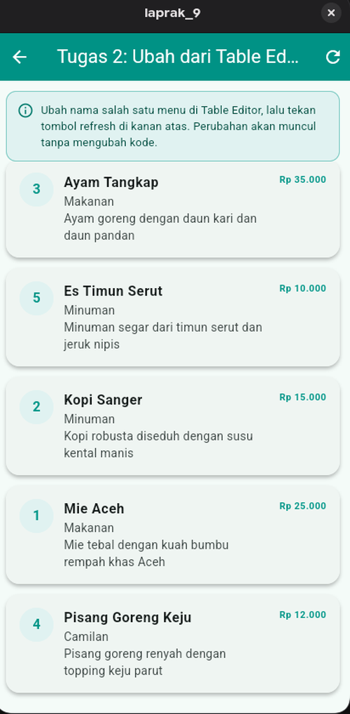

**Gambar 3:** Daftar sebelum nama menu diubah.

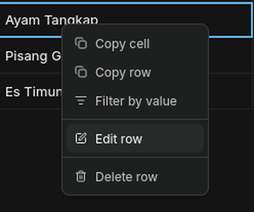

**Gambar 4:** Memilih menu Edit row pada Table Editor.

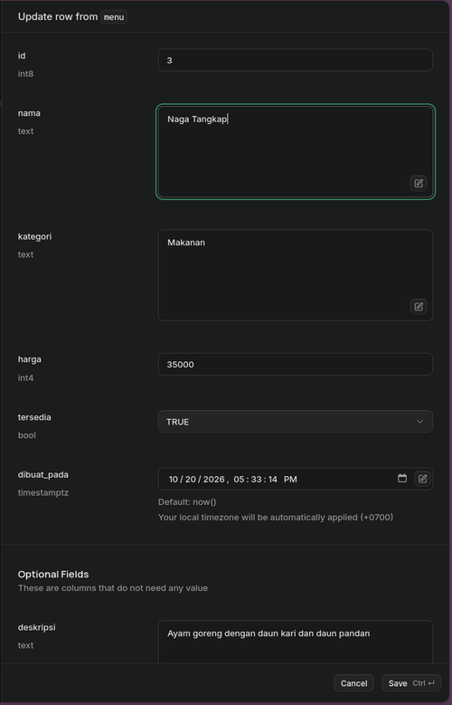

**Gambar 5:** Mengubah kolom `nama` dari Ayam Tangkap menjadi Naga Tangkap.

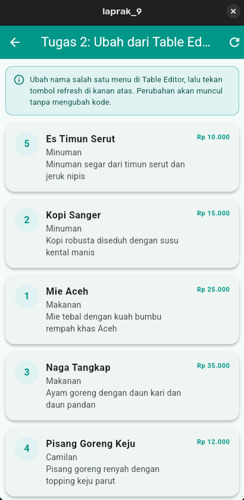

**Gambar 6:** Nama baru muncul dan posisinya berubah setelah refresh.

#### Pembahasan

Alur perubahannya adalah:

1. Table Editor mengirim perintah `UPDATE` ke PostgreSQL.
2. PostgreSQL menyimpan nilai baru pada baris dengan `id = 3`.
3. Saat tombol refresh ditekan, aplikasi mengirim query `SELECT` baru ke Data API.
4. Respons terbaru diubah menjadi `List<MenuItem>` dan `FutureBuilder` membangun ulang daftar.

Perubahan posisi baris bukan bug. Karena query memakai `ORDER BY nama ASC`, nama **Naga Tangkap** kini berada setelah **Mie Aceh**, bukan lagi di posisi awal seperti **Ayam Tangkap**.

---

### 1.3 Baris Baru dari Table Editor

#### Masalah

Apakah baris baru yang ditambahkan langsung dari dashboard dapat muncul di aplikasi tanpa perubahan kode sama sekali?

#### Tugas

- Menambahkan satu baris baru melalui Table Editor.
- Menekan refresh pada aplikasi.
- Menyimpulkan apakah aplikasi benar-benar membaca data secara dinamis.

#### Kode Implementasi

Tidak ada kode aplikasi yang diubah pada tugas ini. Aplikasi tetap memakai query yang sama:

```dart
final data = await Supabase.instance.client
    .from('menu')
    .select()
    .order('nama', ascending: true);
```

#### Hasil Eksekusi {.page-break}

Baris baru ditambahkan dengan data berikut:

| Kolom | Nilai |
|---|---|
| `id` | 6 (dibuat otomatis) |
| `nama` | Durian Gosong |
| `kategori` | Camilan |
| `harga` | 1.000.000 |
| `tersedia` | true |
| `deskripsi` | Durian Segar yang melalui proses penghitaman |
| `dibuat_pada` | 20/10/2026 18:59 |

Setelah refresh, baris **Durian Gosong** muncul di aplikasi. Karena urutannya A–Z, baris ini tampil paling atas (huruf **D** sebelum **E**).

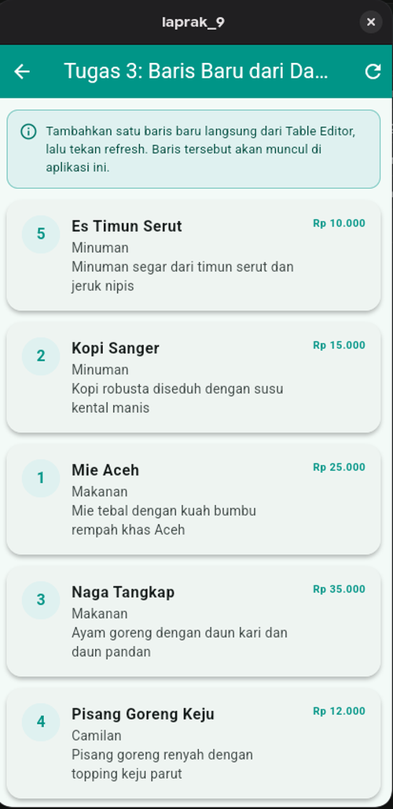

**Gambar 7:** Daftar sebelum baris baru ditambahkan.

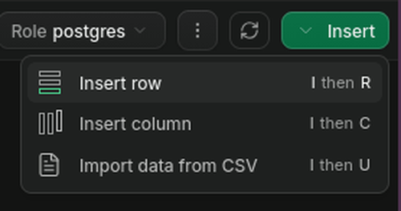

**Gambar 8:** Memilih Insert row pada Table Editor.

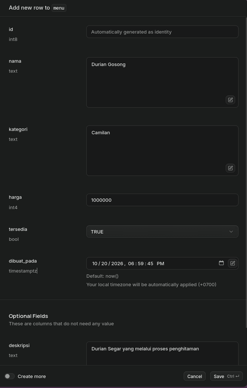

**Gambar 9:** Mengisi data Durian Gosong pada form insert.

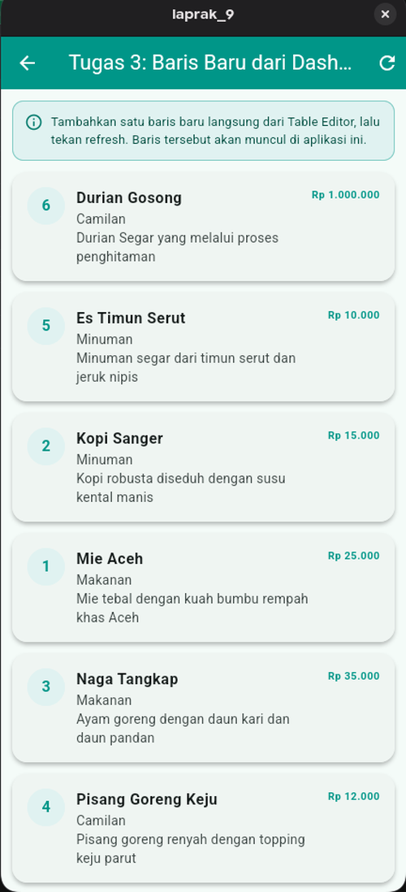

**Gambar 10:** Baris baru langsung tampil setelah refresh tanpa mengubah kode.

#### Pembahasan

Nilai kolom yang tidak diisi pada form diperoleh dari definisi tabel:

- `id` dibuat otomatis oleh PostgreSQL melalui `generated always as identity`.
- `tersedia` memakai nilai default `true`.
- `dibuat_pada` memakai nilai default `now()`.

Kesimpulannya, aplikasi bersifat **data-driven**. Selama struktur kolom tidak berubah, penambahan data tidak memerlukan perubahan kode. Inilah perbedaan utama antara aplikasi yang membaca API publik pada Pertemuan 4 dan aplikasi yang mengelola database sendiri pada Pertemuan 5.

---

### 1.4 Kolom `dibuat_pada` {.page-break}

#### Masalah

Kolom `dibuat_pada` bertipe `timestamptz` di PostgreSQL. Tipe Dart apa yang tepat untuk memetakan kolom tersebut, dan bagaimana cara menampilkannya?

#### Tugas

- Menambahkan kolom `dibuat_pada` sebagai field baru pada model.
- Menentukan tipe Dart yang tepat untuk `timestamptz`.
- Menampilkan nilainya pada daftar menu.

#### Kode Implementasi

Tipe yang dipilih adalah `DateTime?`.

```dart
class MenuItem {
  // ...
  final DateTime? dibuatPada;

  factory MenuItem.fromJson(Map<String, dynamic> json) {
    return MenuItem(
      // ...
      dibuatPada: DateTime.tryParse(json['dibuat_pada'] as String? ?? ''),
    );
  }
}
```

Nilai waktu kemudian diformat agar mudah dibaca.

```dart
String formatTanggal(DateTime? waktu) {
  if (waktu == null) return '-';

  final lokal = waktu.toLocal();
  String duaDigit(int angka) => angka.toString().padLeft(2, '0');

  return '${duaDigit(lokal.day)}/${duaDigit(lokal.month)}/${lokal.year} '
      '${duaDigit(lokal.hour)}:${duaDigit(lokal.minute)}';
}
```

Pada widget daftar, nilai ditampilkan sebagai baris tambahan:

```dart
if (widget.tampilkanDibuatPada) {
  keterangan.write('\nDibuat: ${formatTanggal(menu.dibuatPada)}');
}
```

#### Hasil Eksekusi {.page-break}

Aplikasi menampilkan waktu pembuatan data:

- **Durian Gosong:** `Dibuat: 20/10/2026 18:59`
- **Es Timun Serut, Kopi Sanger, Mie Aceh, Naga Tangkap:** `Dibuat: 20/10/2026 17:33`

Waktu tersebut sesuai dengan nilai `created_at`/`dibuat_pada` yang terlihat di Table Editor. Dashboard menampilkan waktu lokal dengan offset `+0700`, sedangkan aplikasi menampilkannya setelah `toLocal()`.

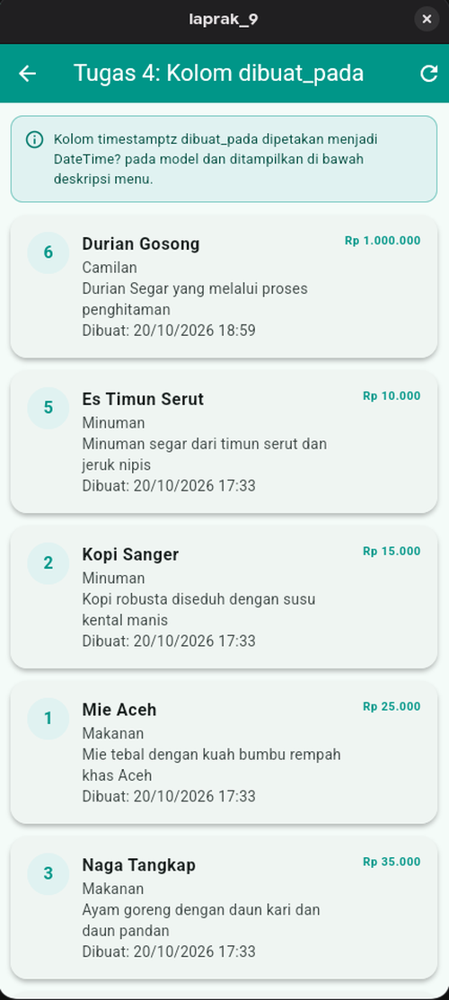

**Gambar 11:** Field `dibuat_pada` berhasil dipetakan ke `DateTime?` dan ditampilkan.

#### Pembahasan

`timestamptz` dikirim oleh Supabase sebagai string berformat ISO-8601, misalnya `2026-10-20T10:33:14.528604+00:00`. String tersebut dapat diubah menjadi `DateTime` menggunakan `DateTime.tryParse()`. Method `tryParse()` dipilih karena mengembalikan `null` bila format tidak valid, sehingga aplikasi tidak langsung crash.

Tipe `DateTime?` (nullable) digunakan agar model tetap aman ketika kolom tidak ikut terambil, bernilai `null`, atau gagal di-parse. Waktu dari server berada dalam UTC; `toLocal()` mengubahnya ke zona waktu perangkat sebelum diformat menjadi `dd/MM/yyyy HH:mm`.

---

### 1.5 Pengurutan Descending {.page-break}

#### Masalah

Apa yang berubah jika parameter `ascending: true` diganti menjadi `ascending: false` pada query?

#### Tugas

- Mengubah pengurutan dari A–Z menjadi Z–A.
- Mengamati urutan data yang tampil.

#### Kode Implementasi

Service dibuat dapat menerima pilihan pengurutan:

```dart
Future<List<MenuItem>> ambilDaftarMenu({bool urutMenurun = false}) async {
  final data = await Supabase.instance.client
      .from('menu')
      .select()
      .order('nama', ascending: !urutMenurun);

  return data.map((baris) => MenuItem.fromJson(baris)).toList();
}
```

Untuk tugas ini, halaman dibuat dengan `urutMenurun: true`:

```dart
return const HalamanDaftarMenu(
  judul: 'Tugas 5: Urutan Z-A',
  urutMenurun: true,
);
```

#### Hasil Eksekusi

Urutan data berubah menjadi:

1. Pisang Goreng Keju
2. Naga Tangkap
3. Mie Aceh
4. Kopi Sanger
5. Es Timun Serut
6. Durian Gosong

Dengan kata lain, urutan sekarang **Z–A**, kebalikan dari tampilan sebelumnya yang **A–Z**.

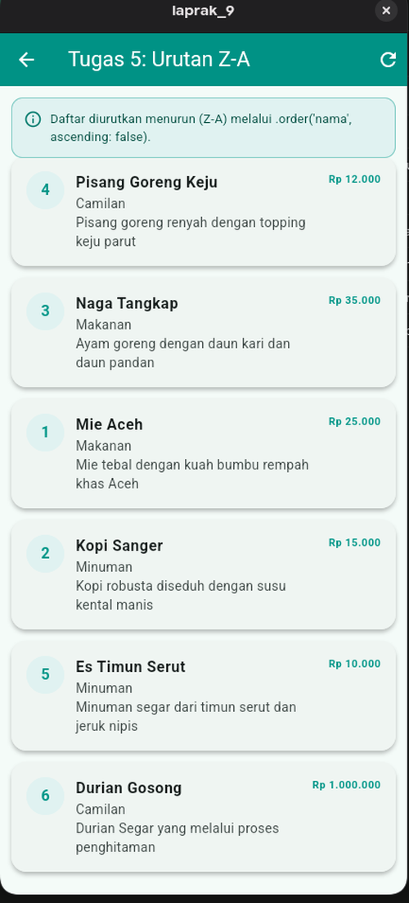

**Gambar 12:** Daftar menu setelah diurutkan menurun berdasarkan nama.

#### Pembahasan

Parameter `ascending: false` diterjemahkan menjadi `ORDER BY nama DESC` pada PostgreSQL. Pengurutan dilakukan di sisi server, bukan dengan membalik `List` di sisi aplikasi. Perubahan ini hanya memengaruhi urutan tampilan; isi dan jumlah data tetap sama. Pengurutan server-side lebih efisien untuk data besar karena aplikasi tidak perlu mengunduh lalu mengurutkan ulang seluruh baris.

---

### 1.6 Pengujian Dua Perangkat

#### Masalah

Jika aplikasi dijalankan pada dua perangkat berbeda, apakah keduanya menampilkan data yang sama?

#### Tugas

- Menjalankan aplikasi pada dua perangkat.
- Membandingkan isi daftar pada keduanya.
- Menjelaskan mengapa hasilnya sama atau berbeda.

#### Kode Implementasi

Tidak ada kode khusus untuk tugas ini. Kedua perangkat menjalankan aplikasi yang sama dan memanggil service yang sama. Pengujian dilakukan dengan:

```bash
# Perangkat 1: Chrome melalui web server
flutter run -d web-server --web-port=2222

# Perangkat 2: desktop Linux
flutter run -d linux
```

#### Hasil Eksekusi

Kedua perangkat menampilkan **enam baris data yang identik**:

| ID | Nama | Kategori | Harga |
|---|---|---|---|
| 6 | Durian Gosong | Camilan | Rp 1.000.000 |
| 5 | Es Timun Serut | Minuman | Rp 10.000 |
| 2 | Kopi Sanger | Minuman | Rp 15.000 |
| 1 | Mie Aceh | Makanan | Rp 25.000 |
| 3 | Naga Tangkap | Makanan | Rp 35.000 |
| 4 | Pisang Goreng Keju | Camilan | Rp 12.000 |

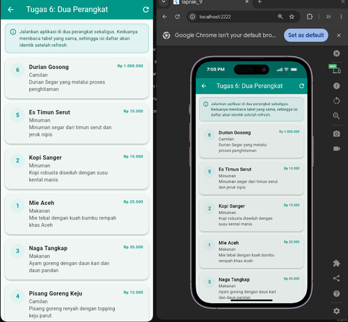

**Gambar 13:** Chrome (kanan) dan aplikasi Linux (kiri) menampilkan daftar yang sama.

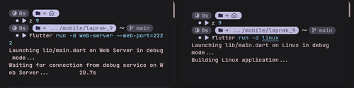

**Gambar 14:** Perintah `flutter run` yang digunakan pada kedua perangkat.

#### Pembahasan

Kedua perangkat membaca **tabel yang sama** di database Supabase. Masing-masing menjalankan query `SELECT` sendiri, lalu menampilkan hasilnya. Karena tidak ada data yang disimpan secara lokal di aplikasi, keduanya menampilkan isi database yang sama.

Pada Latihan 1 ini, pembaruan **belum otomatis**. Jika data diubah dari perangkat pertama atau dari Table Editor, perangkat kedua harus menekan refresh terlebih dahulu. Pembaruan otomatis tanpa tombol refresh akan dibahas pada Latihan 4 menggunakan `.stream()` dan `StreamBuilder`.

---

### 1.7 Catatan Keamanan

#### Publishable Key vs Secret Key

Aplikasi Flutter memuat **publishable key** karena kunci ini hanya berfungsi sebagai identitas aplikasi. Hak akses sebenarnya tetap ditentukan oleh **Row Level Security (RLS)** dan policy di dalam database. Sebaliknya, **secret key** atau **service_role key** memiliki akses penuh dan dapat menembus RLS. Kunci tersebut tidak boleh dimasukkan ke aplikasi client, laporan, maupun repositori.

#### Policy `using (true)`

Policy `using (true)` pada praktikum ini berarti seluruh baris boleh dibaca dan diubah oleh siapa pun yang memiliki publishable key. Pola ini hanya sesuai untuk latihan dan prototipe karena aplikasi belum memiliki sistem login. Pada pertemuan berikutnya, setelah Supabase Auth tersedia, policy dapat dipersempit menjadi berbasis pengguna, misalnya:

```sql
using ((select auth.uid()) = user_id)
```

Dengan begitu, setiap pengguna hanya dapat mengakses datanya sendiri.

---

## Kesimpulan

### Ringkasan Temuan

1. **Data benar-benar berasal dari cloud.** Aplikasi menampilkan data dari tabel `menu` di Supabase, bukan dari data statis di dalam kode. Perubahan di Table Editor muncul setelah refresh.
2. **Aplikasi bersifat data-driven.** Penambahan baris baru dari dashboard tidak memerlukan perubahan kode. Selama struktur tabel sama, aplikasi langsung menampilkan data tersebut.
3. **Model class memetakan tipe PostgreSQL ke Dart.** `bigint` menjadi `int`, `integer` menjadi `int`, `boolean` menjadi `bool`, dan `timestamptz` menjadi `DateTime?` melalui `DateTime.tryParse()`.
4. **Pengurutan dilakukan di server.** `.order('nama', ascending: ...)` menghasilkan `ORDER BY` di PostgreSQL, sehingga perubahan ascending/descending langsung mengubah urutan tanpa mengubah isi data.
5. **Dua perangkat menampilkan data yang sama.** Keduanya membaca tabel yang sama. Pada Latihan 1, sinkronisasi masih manual melalui refresh; realtime akan diterapkan pada Latihan 4.
6. **RLS dan jenis kunci sangat penting.** Publishable key aman dipakai di client selama RLS dan policy dikonfigurasi dengan benar. Secret key tidak boleh pernah dimasukkan ke aplikasi.

### Kendala dan Solusi

| Kendala | Penyebab | Solusi |
|---|---|---|
| Tabel `menu` tidak ditemukan (`PGRST205`) | Skrip SQL bagian C.2 belum dijalankan | Jalankan `supabase/setup.sql` di SQL Editor |
| Data tidak muncul setelah SQL dijalankan | Policy `select` atau `grant` belum ada | Jalankan policy dan `grant select` untuk role `anon` |
| `Invalid API key` | URL atau key salah/kosong | Periksa `lib/config.dart` dan pastikan tidak ada spasi tambahan |
| Aplikasi menampilkan data lama | Belum menekan refresh | Tekan tombol refresh atau tarik daftar ke bawah |
| Waktu tampil berbeda dengan dashboard | Zona waktu perangkat berbeda | Gunakan `toLocal()` sebelum memformat waktu |
| Posisi baris berubah setelah nama diubah | Query memakai `ORDER BY nama` | Hal ini normal; urutan mengikuti nama terbaru |

### Saran untuk Praktikum Selanjutnya

1. Lanjutkan ke Latihan 2–4 untuk melengkapi operasi `INSERT`, `UPDATE`, `DELETE`, dan realtime.
2. Pertahankan `lib/config.dart` di luar repositori dan gunakan `config.example.dart` saat pengumpulan.
3. Manfaatkan struktur modular (`models/`, `services/`, `widgets/`) yang sudah dibuat agar penambahan fitur berikutnya lebih mudah.
4. Setelah fitur login tersedia, persempit policy RLS agar setiap pengguna hanya dapat mengakses datanya sendiri.

---

*Laporan ini disusun sebagai bagian dari tugas Praktikum Pemrograman Mobile, Pertemuan 5 — Latihan 1.*
